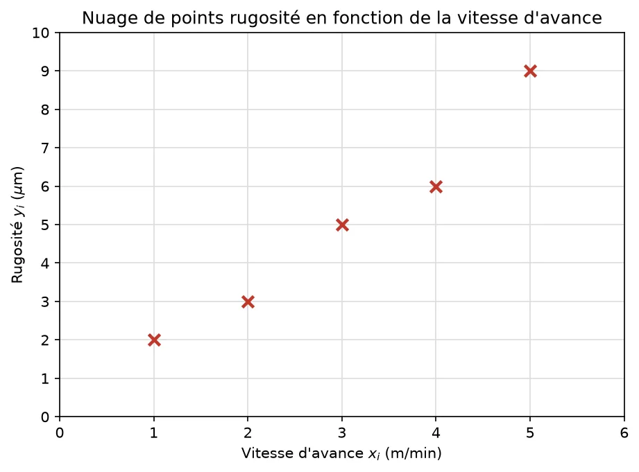
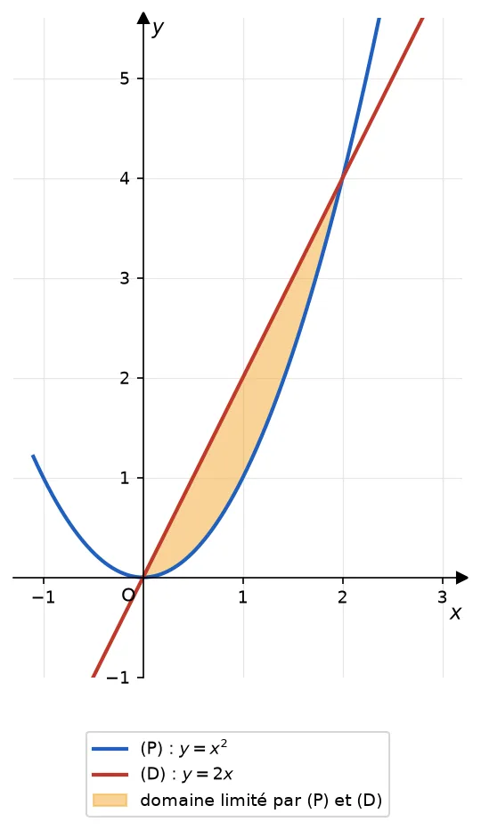
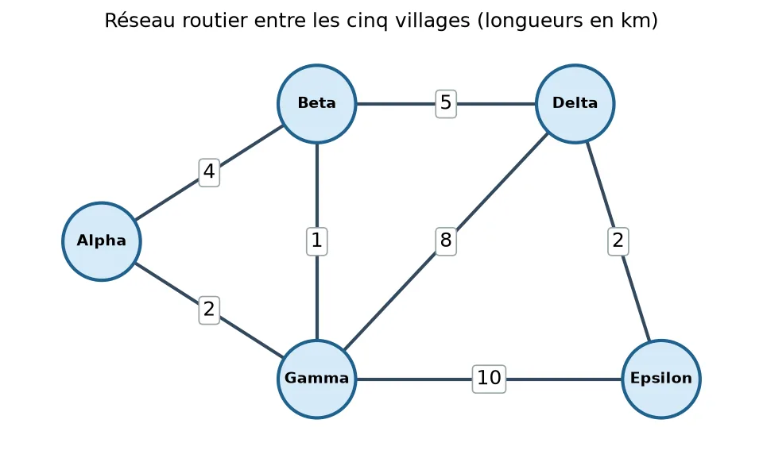
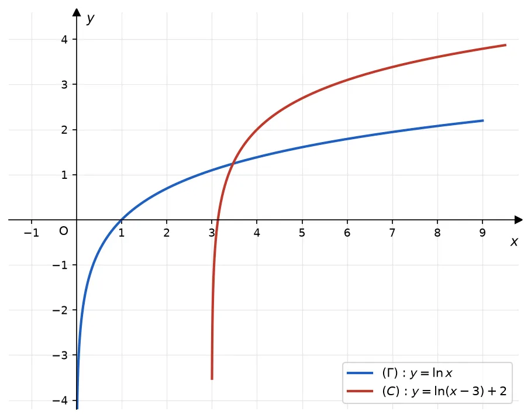

# Vague « figures » (questions avec figure, BEPC retiré) : 55 QCM à faire relire par l'enseignant (campagne B1 maths)

Date : 2026-11-01. Sur 247 questions étudiées, **192** sont converties et 55 écartées. Ce sont des questions dont la figure est affichée **après** la réponse, avec le corrigé (l'énoncé du QCM se suffit à lui-même), et des questions dont vous avez validé le retrait du BEPC (écrites au niveau Probatoire ou BAC). Vous en voyez **55** : celles qui ont une remarque du relecteur aveugle, celles dont des séries ont été retirées, et un tirage de 15 autres. Le lot est prêt mais n'est pas en ligne tant que vous n'avez pas répondu. Les 192 résolutions à l'aveugle donnent la clé, sauf deux questions jugées hors niveau pour la série A (série A retirée) et une donnée inutile retirée (papillon).

## Points à trancher

1. **Figure et corrigé** : le corrigé renvoie à une figure placée après la réponse ; vérifier que ce n'est pas gênant pour les questions de lecture graphique.
2. **Séries A** : calcul intégral en série A (aire entre deux courbes), asymptote oblique, dérivabilité à gauche et à droite, tangente verticale (`tangente-verticale-moyenne-1` : série A retirée).
3. **Probatoire C/E** : distance d'un point à un plan, équation d'un plan, symétrie par rapport à un plan.
4. **Vocabulaire** : `configuration-en-papillon-moyenne-2` parle d'un « portique de balançoire » ; un tréteau serait plus juste.
5. **Limites hautes BEPC** : histogramme à classes inégales (densité), aire latérale du cône, homothétie en coordonnées.

Pour chaque question : **OK**, **à corriger** (dire quoi), **à retirer**, ou **retirer la série X**.

## 1. `cqc-cercle-circonscrit-moyenne-1` (séries BEPC:)

**Énoncé :**

Un carré $EFGH$ a pour côté $10$ cm. On considère le cercle inscrit dans ce carré (tangent à ses quatre côtés) et le cercle circonscrit à ce carré (qui passe par ses quatre sommets). Quels sont, respectivement, le rayon du cercle inscrit et le rayon du cercle circonscrit ?

- a) $5$ cm et $10\sqrt2$ cm
- b) $10$ cm et $10\sqrt2$ cm
- c) $5$ cm et $5\sqrt2$ cm
- d) $5\sqrt2$ cm et $5$ cm

**Clé :** c

Corrigé

### Rappel de méthode

Dans un carré, le centre est équidistant des quatre sommets et des quatre côtés : c'est le centre commun des deux cercles. Le rayon du cercle inscrit est la moitié du côté ; le rayon du cercle circonscrit est la moitié de la diagonale, laquelle vaut $a\sqrt{2}$ pour un carré de côté $a$.

### Corrigé

*Rayon du cercle inscrit.* $r_1=\dfrac{10}{2}=5$ cm.

*Diagonale du carré (Pythagore dans un demi-carré).* $d^{2} = 10^{2} + 10^{2} = 200$, donc $d = \sqrt{200} = 10\sqrt{2}$ cm.

*Rayon du cercle circonscrit.* $r_2 = \dfrac{d}{2} = \dfrac{10\sqrt{2}}{2} = 5\sqrt{2}\approx 7{,}07$ cm.

Le cercle inscrit a pour rayon **5 cm**, le cercle circonscrit a pour rayon **$5\sqrt{2}$ cm**.

### Pourquoi les autres réponses sont fausses

- **a)** $10\sqrt2$ cm est la diagonale, donc le diamètre du cercle circonscrit, pas son rayon.
- **b)** Le côté et la diagonale ont été pris pour des rayons alors que ce sont des diamètres : il faut diviser chacun par $2$.
- **d)** Les deux rayons sont inversés : le cercle circonscrit, qui passe par les sommets, est le plus grand.

Avis : 

---

## 2. `cqc-droites-paralleles-moyenne-2` (séries BAC:D BEPC: PROBATOIRE:C PROBATOIRE:E)

**Remarque du relecteur :** Le choix b est un piège (somme 180° d'angles alternes-internes) : bien vérifier que la figure affichée place F à gauche et C à droite comme dans l'énoncé.

**Énoncé :**

On considère deux droites $(d_1)$ et $(d_2)$ du plan, $(d_1)$ étant tracée au-dessus de $(d_2)$ ; on ne sait pas encore si elles sont parallèles. Une sécante $(\Delta)$ coupe $(d_1)$ en un point $A$ et $(d_2)$ en un point $B$ situé plus bas. Sur $(d_1)$, on place un point $C$ à droite de $A$. Sur $(d_2)$, on place un point $E$ à droite de $B$ et un point $F$ à gauche de $B$, avec $F$, $B$, $E$ alignés dans cet ordre. On place enfin un point $G$ sur $(\Delta)$, au-delà de $B$, c'est-à-dire tel que $A$, $B$ et $G$ soient alignés dans cet ordre, $G$ étant en dessous de $(d_2)$.

On donne $\widehat{CAB} = 71^\circ$ et $\widehat{ABF} = 109^\circ$.

Les droites $(d_1)$ et $(d_2)$ sont-elles parallèles ?

- a) Non, car les angles correspondants $\widehat{CAB}$ et $\widehat{EBG}$ mesurent $71^\circ$ et $109^\circ$.
- b) Oui, car $71^\circ+109^\circ=180^\circ$ : les angles $\widehat{CAB}$ et $\widehat{ABF}$ sont supplémentaires.
- c) Oui, car les angles $\widehat{ABF}$ et $\widehat{EBG}$ sont égaux.
- d) On ne peut pas conclure sans connaître un autre angle formé en $B$.

**Clé :** a

Corrigé

### Rappel de méthode

Si deux droites parallèles sont coupées par une sécante, alors leurs angles correspondants sont égaux. Par contraposée, si deux angles correspondants formés par une sécante sur deux droites ne sont pas égaux, ces deux droites ne sont pas parallèles. Deux angles opposés par le sommet sont toujours égaux, que les droites en présence soient parallèles ou non.

### Corrigé

Les angles $\widehat{ABF}$ et $\widehat{EBG}$ sont opposés par le sommet $B$ (les demi-droites $[BF)$ et $[BE)$ sont opposées, tout comme $[BA)$ et $[BG)$), donc ils sont égaux, indépendamment de tout parallélisme :
$$\widehat{EBG} = \widehat{ABF} = 109^\circ$$

Les angles $\widehat{CAB}$ et $\widehat{EBG}$ sont les angles correspondants formés par la sécante $(\Delta)$ sur $(d_1)$ et $(d_2)$ (tous deux à droite de $(\Delta)$, chacun sous sa droite). Or :
$$\widehat{CAB} = 71^\circ \neq 109^\circ = \widehat{EBG}$$

Les angles correspondants ne sont pas égaux. Par contraposée du théorème des angles correspondants, les droites $(d_1)$ et $(d_2)$ **ne sont pas parallèles**.

### Pourquoi les autres réponses sont fausses

- **b)** $\widehat{CAB}$ et $\widehat{ABF}$ sont alternes-internes (de part et d'autre de la sécante) : pour des parallèles, ils seraient égaux, pas supplémentaires.
- **c)** Ces deux angles sont opposés par le sommet : ils sont toujours égaux, cela ne dit rien sur le parallélisme.
- **d)** L'angle $\widehat{EBG}$ se déduit de $\widehat{ABF}$ (opposés par le sommet), ce qui suffit pour comparer des angles correspondants.

Avis : 

---

## 3. `cqc-geometrie-dans-l-espace-faible-0` (séries BAC:C BAC:D BAC:E PROBATOIRE:C PROBATOIRE:E)

**Remarque du relecteur :** Au Probatoire, sans produit vectoriel, l'élève doit passer par les longueurs (triangle isocèle) : faisable mais plus long.

**Énoncé :**

Dans l'espace muni d'un repère orthonormé $(O;\vec\imath,\vec\jmath,\vec k)$, on considère les points $P(1;0;2)$, $Q(3;1;-1)$ et $R(0;2;1)$. Quelle est l'aire du triangle $PQR$, en unités d'aire ?

- a) $5\sqrt3$
- b) $\dfrac{5\sqrt3}{2}$
- c) $\sqrt{21}$
- d) $\dfrac{75}{2}$

**Clé :** b

Corrigé

### Rappel de méthode

L'aire d'un triangle $PQR$ vaut $\dfrac12\,PQ\times PR\times\sin\widehat{QPR}$. Le cosinus de l'angle s'obtient par le produit scalaire : $\cos\widehat{QPR}=\dfrac{\vec{PQ}\cdot\vec{PR}}{PQ\times PR}$, et $\sin^2=1-\cos^2$. On en tire la formule $\text{Aire}=\dfrac12\sqrt{PQ^2\times PR^2-\left(\vec{PQ}\cdot\vec{PR}\right)^2}$.

### Corrigé

$\vec{PQ}=(3-1\,;\,1-0\,;\,-1-2)=(2\,;\,1\,;\,-3)$ et $\vec{PR}=(0-1\,;\,2-0\,;\,1-2)=(-1\,;\,2\,;\,-1)$.

$PQ^2=4+1+9=14$, $PR^2=1+4+1=6$ et $\vec{PQ}\cdot\vec{PR}=2\times(-1)+1\times2+(-3)\times(-1)=-2+2+3=3$.

$$\sin^2\widehat{QPR}=1-\dfrac{(\vec{PQ}\cdot\vec{PR})^2}{PQ^2\times PR^2}=1-\dfrac{9}{84}=\dfrac{75}{84}$$

$$\text{Aire}(PQR)=\dfrac12\sqrt{14\times6-9}=\dfrac12\sqrt{75}=\dfrac{5\sqrt3}{2}\approx4{,}33$$

### Pourquoi les autres réponses sont fausses

- **a)** C'est l'aire du parallélogramme construit sur $\vec{PQ}$ et $\vec{PR}$ : le facteur $\dfrac12$ a été oublié.
- **c)** On a calculé $\dfrac12\,PQ\times PR=\dfrac12\sqrt{84}$ comme si le triangle était rectangle en $P$, alors que $\vec{PQ}\cdot\vec{PR}=3\neq0$.
- **d)** La racine carrée a été oubliée : $\dfrac12(84-9)$ au lieu de $\dfrac12\sqrt{84-9}$.

Avis : 

---

## 4. `cqc-histogramme-moyenne-0` (séries BAC:A BEPC: PROBATOIRE:A PROBATOIRE:C PROBATOIRE:D PROBATOIRE:E)

**Remarque du relecteur :** LIMITE : histogramme à classes inégales (densité) pour le BEPC, la définition est heureusement donnée dans l'énoncé.

**Énoncé :**

Un marché de gros a pesé, en kilogrammes, les cargaisons de plantains livrées par 64 camions un jour de forte affluence, et a obtenu le tableau suivant, où les classes n'ont pas toutes la même amplitude :

| Masse de la cargaison (kg) | $[500\,;800[$ | $[800\,;1000[$ | $[1000\,;1100[$ | $[1100\,;1400[$ |
|---|---|---|---|---|
| Nombre de camions $n_i$ | 15 | 16 | 12 | 21 |

Dans l'histogramme, la hauteur du rectangle d'une classe est sa densité $h_i=\dfrac{n_i}{a_i}$ (effectif divisé par amplitude). Quelles sont les hauteurs des quatre rectangles, dans l'ordre des classes ?

- a) $15$ ; $16$ ; $12$ ; $21$
- b) $0{,}15$ ; $0{,}16$ ; $0{,}12$ ; $0{,}21$
- c) $0{,}23$ ; $0{,}25$ ; $0{,}19$ ; $0{,}33$
- d) $0{,}05$ ; $0{,}08$ ; $0{,}12$ ; $0{,}07$

**Clé :** d

Corrigé

### Rappel de méthode

Dans un histogramme, c'est l'aire de chaque rectangle, et non sa hauteur, qui doit être proportionnelle à l'effectif de la classe. Quand les amplitudes diffèrent, on prend pour hauteur la densité $h_i=\dfrac{n_i}{a_i}$ : ainsi, aire $=h_i\times a_i=n_i$, quelle que soit la largeur de la classe.

### Corrigé

Amplitudes : $800-500=300$, $1000-800=200$, $1100-1000=100$, $1400-1100=300$.

Hauteurs (densités) :
$$h_1=\dfrac{15}{300}=0{,}05 \qquad h_2=\dfrac{16}{200}=0{,}08 \qquad h_3=\dfrac{12}{100}=0{,}12 \qquad h_4=\dfrac{21}{300}=0{,}07$$

Contrôle par les aires (hauteur $\times$ amplitude) : $300\times0{,}05=15$, $200\times0{,}08=16$, $100\times0{,}12=12$, $300\times0{,}07=21$, de somme $64$, l'effectif total. On remarque que la classe $[1000\,;1100[$, la moins peuplée ($12$ camions), a le rectangle le plus haut : elle concentre son effectif sur une amplitude étroite ($100$ kg).

### Pourquoi les autres réponses sont fausses

- **a)** Ce sont les effectifs bruts : cette hauteur ne convient que si toutes les classes ont la même amplitude.
- **b)** Tous les effectifs ont été divisés par $100$, comme si toutes les classes avaient l'amplitude de $[1000\,;1100[$.
- **c)** Ce sont les fréquences $\dfrac{n_i}{64}$ arrondies, et non les densités $\dfrac{n_i}{a_i}$.

Avis : 

---

## 5. `cqc-moyenne-moyenne-1` (séries PROBATOIRE:A PROBATOIRE:C PROBATOIRE:D PROBATOIRE:E)

**Remarque du relecteur :** Le distracteur b (5,43) est l'arrondi : la consigne de troncature est bien explicite.

**Énoncé :**

Un vétérinaire a recensé le nombre de vaccins administrés à 7 chiots d'une même portée au cours d'un mois. Les résultats sont donnés dans le tableau suivant :

| Nombre de vaccins $x_i$ | 0 | 2 | 3 | 4 | 6 |
|---|---|---|---|---|---|
| Nombre de chiots $n_i$ | 2 | 1 | 1 | 1 | 2 |

Quelle est la variance $V$ de cette série, **tronquée au centième** (on garde deux chiffres après la virgule, sans arrondir) ?

- a) $5{,}42$
- b) $5{,}43$
- c) $14{,}42$
- d) $4{,}00$

**Clé :** a

Corrigé

### Rappel de méthode

La variance se calcule par $V=\dfrac{1}{N}\sum n_ix_i^2-\bar x^{\,2}$, en tenant compte des effectifs. Tronquer au centième signifie ne conserver que les deux premiers chiffres après la virgule, en supprimant les suivants, sans appliquer de règle d'arrondi : même si le troisième chiffre vaut $5$ ou plus, le deuxième chiffre conservé ne change pas.

### Corrigé

L'effectif total est $N=2+1+1+1+2=7$.

$$\bar x=\frac{2\times0+1\times2+1\times3+1\times4+2\times6}{7}=\frac{21}{7}=3$$

$$\sum n_ix_i^2=2\times0^2+1\times2^2+1\times3^2+1\times4^2+2\times6^2=0+4+9+16+72=101$$

$$V=\frac{101}{7}-3^2=\frac{101-63}{7}=\frac{38}{7}=5{,}428571\ldots$$

En tronquant au centième, on conserve $5{,}42$. Attention : l'arrondi au centième donnerait $5{,}43$ (le troisième chiffre, $8$, est supérieur à $5$), mais la consigne demande une troncature. Le résultat attendu est $V\approx5{,}42$.

### Pourquoi les autres réponses sont fausses

- **b)** C'est l'arrondi au centième de $\dfrac{38}{7}$, pas la troncature demandée.
- **c)** On a oublié de retrancher le carré de la moyenne : $\dfrac{101}{7}\approx14{,}43$ n'est que la moyenne des carrés.
- **d)** Les effectifs ont été ignorés : on a traité la série comme cinq valeurs comptées une seule fois chacune.

Avis : 

---

## 6. `cqc-tangente-a-une-courbe-moyenne-3` (séries BAC:A BAC:C BAC:D BAC:E PROBATOIRE:A)

**Remarque du relecteur :** LIMITE : tangentes issues d'un point extérieur, exercice classique de série C, exigeant pour la Probatoire A (plus faible série listée).

**Énoncé :**

Soit $(P)$ la parabole d'équation $y=x^2$ et $P_0$ le point de coordonnées $(1\,;-3)$. Quelles sont les tangentes à $(P)$ passant par $P_0$ ?

- a) $y=6x-9$ et $y=-2x-1$
- b) $y=2x-5$ seulement
- c) $y=-6x-9$ et $y=2x-1$
- d) Aucune tangente ne passe par $P_0$

**Clé :** a

Corrigé

### Rappel de méthode

Le point $P_0$ n'appartient pas à la courbe : on ne peut donc pas l'utiliser comme point de contact. On écrit la tangente au point d'abscisse inconnue $a$, $y=f(a)+f'(a)(x-a)$, puis on impose qu'elle passe par $P_0$ pour trouver $a$.

### Corrigé

Avec $f(x)=x^2$, la tangente au point d'abscisse $a$ est $y=a^2+2a(x-a)=2ax-a^2$.

Elle passe par $P_0(1\,;-3)$ si et seulement si $-3=2a-a^2$, c'est-à-dire $a^2-2a-3=0$, ou encore $(a-3)(a+1)=0$ : $a=3$ ou $a=-1$.

- Pour $a=3$ : $y=6x-9$ (en $x=1$, $y=-3$).
- Pour $a=-1$ : $y=-2x-1$ (en $x=1$, $y=-3$).

Il y a donc deux tangentes à $(P)$ passant par $P_0$ : $y=6x-9$ et $y=-2x-1$.

### Pourquoi les autres réponses sont fausses

- **b)** $P_0$ a été pris comme point de contact (tangente en $x=1$), alors que $1^2=1\neq-3$ : $P_0$ n'est pas sur la parabole.
- **c)** Erreur de signe en factorisant $a^2-2a-3$ : les racines sont $3$ et $-1$, pas $-3$ et $1$ ; ces droites ne passent pas par $P_0$.
- **d)** Erreur de signe dans l'équation de la tangente ($2ax+a^2$ au lieu de $2ax-a^2$), qui mène à une équation $a^2+2a+3=0$ sans racine.

Avis : 

---

## 7. `cqc-trace-de-droites-moyenne-1` (séries BEPC:)

**Énoncé :**

Deux droites sont données par leurs équations : $(D_1) : y = 100x$ et $(D_2) : y = 50x + 300$. L'échelle du repère est de $1$ cm pour $5$ unités en abscisse, et $1$ cm pour $100$ unités en ordonnée. Où faut-il placer, sur le tracé, le point d'intersection de $(D_1)$ et $(D_2)$ ?

- a) À $6$ cm à droite de l'origine et $6$ cm au-dessus
- b) À $30$ cm à droite de l'origine et $6$ cm au-dessus
- c) À $1{,}2$ cm à droite de l'origine et $6$ cm au-dessus
- d) À $0{,}4$ cm à droite de l'origine et $2$ cm au-dessus

**Clé :** c

Corrigé

### Rappel de méthode

Le point d'intersection de deux droites s'obtient en résolvant l'équation obtenue en égalant leurs deux expressions. Une fois ses coordonnées connues, on les convertit en centimètres en respectant l'échelle propre à chaque axe.

### Corrigé

**Point d'intersection.**
$$100x = 50x + 300 \iff 50x = 300 \iff x = 6, \qquad y = 100 \times 6 = 600$$

*Vérification avec $(D_2)$.* $50 \times 6 + 300 = 600$.

Le point d'intersection a pour coordonnées $(6\,;\,600)$.

**Position en centimètres.** Abscisse : $6 \div 5 = 1{,}2$ cm. Ordonnée : $600 \div 100 = 6$ cm.

Le point se place à $1{,}2$ cm à droite de l'origine et $6$ cm au-dessus.

### Pourquoi les autres réponses sont fausses

- **a)** L'échelle de l'axe des abscisses a été oubliée : $6$ unités représentent $6\div5=1{,}2$ cm.
- **b)** On a multiplié par $5$ au lieu de diviser : $1$ cm représente $5$ unités, donc $6$ unités font $1{,}2$ cm.
- **d)** Erreur de signe en regroupant les termes ($150x=300$ au lieu de $50x=300$), d'où le point faux $(2\,;\,200)$.

Avis : 

---

## 8. `cqc-asymptotes-moyenne-3` (séries BAC:A BAC:C BAC:D BAC:E BAC:TI PROBATOIRE:A PROBATOIRE:C PROBATOIRE:D PROBATOIRE:E)

**Remarque du relecteur :** LIMITE : asymptote oblique (admise) au niveau Probatoire A, série la plus faible listée.

**Énoncé :**

Soit $f$ la fonction définie sur $\mathbb{R}\setminus\{-2\}$ par
$$f(x)=x-1+\dfrac{3}{x+2}.$$
On admet que la droite $(D)$ d'équation $y=x-1$ est asymptote oblique à la courbe $(C)$ de $f$ en $+\infty$ et en $-\infty$.

Quelle est la position de $(C)$ par rapport à $(D)$ ?

- a) $(C)$ est au-dessus de $(D)$ sur tout $\mathbb{R}\setminus\{-2\}$.
- b) $(C)$ est au-dessus de $(D)$ sur $\left]-2\,;+\infty\right[$ et en dessous de $(D)$ sur $\left]-\infty\,;-2\right[$.
- c) $(C)$ est en dessous de $(D)$ sur $\left]-2\,;+\infty\right[$ et au-dessus de $(D)$ sur $\left]-\infty\,;-2\right[$.
- d) $(C)$ est au-dessus de $(D)$ sur $\left]1\,;+\infty\right[$ et en dessous de $(D)$ sur $\left]-\infty\,;1\right[$.

**Clé :** b

Corrigé

### Rappel de méthode

Pour étudier la position d'une courbe $(C)$ par rapport à une droite $(D):y=ax+b$, on étudie le signe de la différence $f(x)-(ax+b)$ : là où elle est positive, $(C)$ est au-dessus de $(D)$ ; là où elle est négative, $(C)$ est en dessous ; là où elle s'annule, $(C)$ coupe $(D)$.

### Corrigé

$$f(x)-(x-1)=\left(x-1+\dfrac{3}{x+2}\right)-(x-1)=\dfrac{3}{x+2}.$$

Le numérateur $3$ est strictement positif, donc le signe est celui de $x+2$ :
- si $x>-2$, alors $\dfrac{3}{x+2}>0$ : $(C)$ est **au-dessus** de $(D)$ ;
- si $x<-2$, alors $\dfrac{3}{x+2}<0$ : $(C)$ est **en dessous** de $(D)$.

Comme $\dfrac{3}{x+2}$ ne s'annule jamais, $(C)$ ne coupe pas $(D)$.

### Pourquoi les autres réponses sont fausses

- **a)** On n'a regardé que le numérateur $3>0$ en oubliant que le dénominateur $x+2$ change de signe en $-2$.
- **c)** Les positions sont inversées : pour $x=0$, la différence vaut $\dfrac32>0$, donc $(C)$ est au-dessus de $(D)$ sur $\left]-2\,;+\infty\right[$.
- **d)** On a étudié le signe de $x-1$ (l'ordonnée de $(D)$) au lieu du signe de la différence $f(x)-(x-1)$.

Avis : 

---

## 9. `cqc-tableau-de-valeurs-prob-c-moyenne-3` (séries PROBATOIRE:C)

**Remarque du relecteur :** Le tableau de valeurs seul ne prouve pas le sens de variation ; la réponse s'obtient par la dérivée, l'énoncé pourrait le suggérer.

**Énoncé :**

Soit $f$ la fonction définie sur $[-2\,;2]$ par $f(x)=x^3-3x$. Un tableau de valeurs donne $f(-2)=-2$, $f(-1)=2$, $f(0)=0$, $f(1)=-2$ et $f(2)=2$.

Quel est le sens de variation de $f$ sur $[-2\,;2]$ ?

- a) $f$ est croissante sur $[-2\,;2]$.
- b) $f$ est décroissante sur $[-2\,;-1]$, croissante sur $[-1\,;1]$ et décroissante sur $[1\,;2]$.
- c) $f$ est croissante sur $[-2\,;-1]$, décroissante sur $[-1\,;1]$ et croissante sur $[1\,;2]$.
- d) $f$ est croissante sur $[-2\,;0]$, décroissante sur $[0\,;1]$ et croissante sur $[1\,;2]$.

**Clé :** c

Corrigé

### Rappel de méthode

Un tableau de valeurs donne quelques points de la courbe, pas les variations exactes : entre deux valeurs, la fonction peut changer de sens. Pour conclure, il faut étudier le signe de $f'$.

### Corrigé

Les valeurs $f(-2)=-2$, $f(-1)=2$, $f(0)=0$, $f(1)=-2$, $f(2)=2$ ne suffisent pas à elles seules. On calcule :
$$f'(x)=3x^2-3=3(x-1)(x+1).$$
$f'(x)>0$ sur $\left]-2\,;-1\right[$ et sur $\left]1\,;2\right[$, $f'(x)<0$ sur $\left]-1\,;1\right[$. Donc $f$ est croissante sur $[-2\,;-1]$, décroissante sur $[-1\,;1]$ et croissante sur $[1\,;2]$.

### Pourquoi les autres réponses sont fausses

- **a)** Comparer seulement $f(-2)=-2$ et $f(2)=2$ ne donne pas le sens de variation : $f(-1)=2>f(1)=-2$ montre que $f$ décroît quelque part.
- **b)** Le signe de $f'$ est inversé : $f'(-1{,}5)=3{,}75>0$, donc $f$ croît au voisinage de $-1{,}5$.
- **d)** Cela correspond à la dérivée fausse $3x^2-3x$ (la dérivée de $-3x$ est $-3$, pas $-3x$) ; d'ailleurs $f(-1)=2>f(0)=0$.

Avis : 

---

## 10. `cqc-integration-par-parties-moyenne-2` (séries BAC:C BAC:D BAC:E)

**Remarque du relecteur :** VOCABULAIRE : une « intensité » de signal en fonction du temps n'a pas d'aire concrète comme sens physique ; le contexte est artificiel et peut être retiré.

**Énoncé :**

L'intensité d'un signal est modélisée, pour $t\in[0\,;\pi]$ (en secondes), par la fonction $h(t)=t\sin t$, positive sur cet intervalle.

Quelle est la valeur de $\displaystyle\int_0^{\pi}t\sin t\,dt$, aire en unités d'aire comprise entre la courbe de $h$ et l'axe des abscisses ?

- a) $-\pi$
- b) $\pi^2$
- c) $2$
- d) $\pi$

**Clé :** d

Corrigé

### Rappel de méthode

Pour le produit d'un polynôme et d'une fonction trigonométrique, on choisit $u$ égal au polynôme, dont la dérivée est plus simple, et $v'$ égal à la fonction trigonométrique, dont une primitive est immédiate. La formule $\int_a^b u(x)v'(x)\,dx=\big[u(x)v(x)\big]_a^b-\int_a^b u'(x)v(x)\,dx$ s'applique alors directement.

### Corrigé

On pose $u(t)=t$ et $v'(t)=\sin t$, d'où $u'(t)=1$ et $v(t)=-\cos t$.
$$\int_0^{\pi}t\sin t\,dt=\big[-t\cos t\big]_0^{\pi}+\int_0^{\pi}\cos t\,dt=\big(-\pi\cos\pi-0\big)+\big[\sin t\big]_0^{\pi}.$$
Comme $\cos\pi=-1$ et $\sin\pi-\sin0=0$ :
$$\int_0^{\pi}t\sin t\,dt=\pi+0=\pi.$$

Le résultat est positif, ce qui est cohérent avec $h(t)\geqslant0$ sur $[0\,;\pi]$.

### Pourquoi les autres réponses sont fausses

- **a)** On a pris $v(t)=\cos t$ comme primitive de $\sin t$ (erreur de signe) : une aire ne peut pas être négative.
- **b)** On a « intégré séparément » les deux facteurs : $\int_0^\pi t\,dt\times\int_0^\pi\sin t\,dt=\dfrac{\pi^2}{2}\times2=\pi^2$, ce qui est faux pour un produit.
- **c)** $2$ est la valeur de $\int_0^{\pi}\sin t\,dt$ : on a oublié le facteur $t$.

Avis : 

---

## 11. `cqc-plan-moyenne-0` (séries BAC:C BAC:E PROBATOIRE:C PROBATOIRE:E)

**Remarque du relecteur :** LIMITE : équation cartésienne de plan dans l'espace au niveau Probatoire C/E (faisable par système, sans produit vectoriel).

**Énoncé :**

Dans l'espace muni d'un repère orthonormé $(O;\vec\imath,\vec\jmath,\vec k)$, on donne les points non alignés $P(2;1;0)$, $Q(0;3;1)$ et $R(1;0;4)$.

Quelle est une équation cartésienne du plan $(PQR)$ ?

- a) $9x+7y+4z-25=0$
- b) $9x+7y+4z+25=0$
- c) $9x-7y+4z-11=0$
- d) $7x+9y+4z-23=0$

**Clé :** a

Corrigé

### Rappel de méthode

Pour déterminer une équation cartésienne d'un plan connu par trois points non alignés $P$, $Q$, $R$, on calcule deux vecteurs du plan, $\overrightarrow{PQ}$ et $\overrightarrow{PR}$, puis on cherche un vecteur $\vec n(a;b;c)$ orthogonal à ces deux vecteurs en résolvant $\vec n\cdot\overrightarrow{PQ}=0$ et $\vec n\cdot\overrightarrow{PR}=0$. On écrit ensuite $a(x-x_P)+b(y-y_P)+c(z-z_P)=0$.

### Corrigé

$\overrightarrow{PQ}=(-2;2;1)$ et $\overrightarrow{PR}=(-1;-1;4)$.

On cherche $\vec n(a;b;c)$ tel que $-2a+2b+c=0$ (i) et $-a-b+4c=0$ (ii). De (ii) : $a=4c-b$ ; en reportant dans (i) : $-8c+2b+2b+c=0$, soit $4b=7c$. Avec $c=4$ : $b=7$ et $a=16-7=9$. Donc $\vec n(9;7;4)$.

Vérification : $\vec n\cdot\overrightarrow{PQ}=-18+14+4=0$ et $\vec n\cdot\overrightarrow{PR}=-9-7+16=0$.

Le plan passe par $P(2;1;0)$ : $9(x-2)+7(y-1)+4z=0$, soit
$$9x+7y+4z-25=0.$$

Contrôle : $Q$ donne $0+21+4-25=0$ et $R$ donne $9+0+16-25=0$.

### Pourquoi les autres réponses sont fausses

- **b)** Erreur de signe sur la constante : $P$ donne $18+7+0+25=50\neq0$.
- **c)** Erreur de signe sur $b$ : le vecteur $(9;-7;4)$ n'est pas orthogonal à $\overrightarrow{PQ}$ ($-18-14+4=-28$), et $Q$ ne vérifie pas l'équation.
- **d)** Les coordonnées $a$ et $b$ du vecteur normal ont été interverties : $Q$ donne $0+27+4-23=8\neq0$.

Avis : 

---

## 12. `cqc-polynome-moyenne-2` (séries BAC:A PROBATOIRE:A PROBATOIRE:C PROBATOIRE:E)

**Énoncé :**

On considère le polynôme $P$ défini pour tout réel $x$ par $$P(x)=x^3-2x^2-5x+6.$$ On vérifie que $P(1)=0$.

Quel est le polynôme $Q(x)$ du second degré tel que $P(x)=(x-1)Q(x)$ ?

- a) $Q(x)=x^2-3x-2$
- b) $Q(x)=x^2+x-6$
- c) $Q(x)=x^2-2x-5$
- d) $Q(x)=x^2-x-6$

**Clé :** d

Corrigé

### Rappel de méthode

Si un réel $a$ annule un polynôme $P$, c'est-à-dire si $P(a)=0$, alors $(x-a)$ divise $P(x)$ exactement : la division de $P(x)$ par $(x-a)$ donne un reste nul, et $P(x)=(x-a)Q(x)$ avec un quotient $Q(x)$ de degré inférieur d'une unité.

### Corrigé

$P(1)=1-2-5+6=0$, donc $(x-1)$ divise $P(x)$.

On effectue la division de $x^3-2x^2-5x+6$ par $x-1$.

**Étape 1.** $\dfrac{x^3}{x}=x^2$ ; $(x-1)x^2=x^3-x^2$ ; reste partiel : $-x^2-5x+6$.

**Étape 2.** $\dfrac{-x^2}{x}=-x$ ; $(x-1)(-x)=-x^2+x$ ; reste partiel : $-6x+6$.

**Étape 3.** $\dfrac{-6x}{x}=-6$ ; $(x-1)(-6)=-6x+6$ ; reste : $0$.

Le quotient est $Q(x)=x^2-x-6$.

**Vérification :** $(x-1)(x^2-x-6)=x^3-x^2-6x-x^2+x+6=x^3-2x^2-5x+6=P(x)$.

### Pourquoi les autres réponses sont fausses

- **a)** On a divisé par $x+1$ au lieu de $x-1$ (méthode de Horner avec $-1$) : $(x-1)(x^2-3x-2)=x^3-4x^2+x+2\neq P(x)$.
- **b)** Erreur de signe à l'étape 2 : $(x-1)(x^2+x-6)=x^3-7x+6\neq P(x)$.
- **c)** On a simplement recopié les coefficients de $P$ en abaissant les degrés, sans effectuer la division.

Avis : 

---

## 13. `cqc-translation-elevee-0` (séries BAC:C BAC:E PROBATOIRE:C PROBATOIRE:D PROBATOIRE:E)

**Remarque du relecteur :** LIMITE : composée de réflexions à axes parallèles, à vérifier pour la Probatoire D (plus faible série listée).

**Énoncé :**

Le plan est muni d'un repère orthonormé. On considère les droites $(\Delta)$ d'équation $x=-1$ et $(\Delta')$ d'équation $x=4$, les réflexions $s_\Delta$ et $s_{\Delta'}$ d'axes respectifs $(\Delta)$ et $(\Delta')$, et l'application $f=s_{\Delta'}\circ s_\Delta$.

Quelle est la nature de $f$ ?

- a) La translation de vecteur $(5\,;\,0)$.
- b) La translation de vecteur $(-10\,;\,0)$.
- c) La translation de vecteur $(10\,;\,0)$.
- d) La translation de vecteur $(6\,;\,0)$.

**Clé :** c

Corrigé

### Rappel de méthode

La composée de deux réflexions d'axes parallèles est une translation, de vecteur $2\overrightarrow{HH'}$, où $H$ et $H'$ sont les projetés orthogonaux d'un même point sur le premier puis sur le second axe. Pour une droite verticale d'équation $x=k$, la réflexion associe à $M(x;y)$ le point $M'(2k-x;y)$.

### Corrigé

$s_\Delta(M)=(-2-x\,;\,y)$, puis $s_{\Delta'}\big(s_\Delta(M)\big)=\big(8-(-2-x)\,;\,y\big)=(x+10\,;\,y)$.

Ainsi $f(M)=(x+10\,;\,y)$ pour tout point $M$ : chaque point est déplacé du même vecteur $(10;0)$.

Vérification : pour $A(0;2)$, $s_\Delta(A)=(-2;2)$ puis $f(A)=(10;2)$ ; les projetés de $A$ sur les axes sont $H(-1;2)$ et $H'(4;2)$, et $2\overrightarrow{HH'}=2(5;0)=(10;0)=\overrightarrow{AA_2}$ où $A_2=f(A)$.

$f$ est la translation de vecteur $(10;0)$.

### Pourquoi les autres réponses sont fausses

- **a)** On a oublié le facteur $2$ : $(5;0)$ est le vecteur $\overrightarrow{HH'}$, pas $2\overrightarrow{HH'}$.
- **b)** C'est la composée dans l'ordre inverse, $s_\Delta\circ s_{\Delta'}$ : on applique d'abord $s_\Delta$, puis $s_{\Delta'}$.
- **d)** Erreur de signe sur la distance entre les axes : $4-(-1)=5$, et non $4+(-1)=3$.

Avis : 

---

## 14. `cqc-lecture-graphique-prob-a-faible-0` (séries BAC:A PROBATOIRE:A)

**Énoncé :**

On dispose de la courbe représentative d'une fonction $f$ dans un repère, et d'un réel $b$.

Comment détermine-t-on graphiquement les antécédents de $b$ par $f$ ?

- a) On place $b$ sur l'axe des abscisses, on rejoint la courbe verticalement et on lit l'ordonnée du point obtenu.
- b) On trace la droite horizontale d'équation $y=b$ ; les ordonnées de ses points d'intersection avec la courbe sont les antécédents de $b$.
- c) On trace la droite horizontale d'équation $y=b$ ; les abscisses de ses points d'intersection avec la courbe sont les antécédents de $b$ (il peut y en avoir plusieurs, ou aucun).
- d) On trace la droite horizontale d'équation $y=b$ ; l'abscisse de son unique point d'intersection avec la courbe est l'antécédent de $b$.

**Clé :** c

Corrigé

### Rappel de méthode

Sur la courbe représentative, l'abscisse donne la variable et l'ordonnée la valeur de la fonction.

### Corrigé

**Image** d'un réel $a$ : on part de l'abscisse $a$ sur l'axe horizontal, on monte (ou descend) jusqu'à la courbe puis on lit l'ordonnée : c'est $f(a)$.

**Antécédents** de $b$ : on cherche les réels $x$ tels que $f(x)=b$. On trace donc la droite horizontale d'équation $y=b$ ; les **abscisses** de ses points d'intersection avec la courbe sont les antécédents de $b$ (il peut y en avoir plusieurs, ou aucun). La bonne réponse est **c)**.

### Pourquoi les autres réponses sont fausses

- **a)** Cette démarche donne l'image $f(b)$ de $b$, pas ses antécédents : confusion entre image et antécédent.
- **b)** La bonne droite est tracée, mais ce sont les abscisses des points d'intersection qu'il faut lire ; leurs ordonnées valent toutes $b$.
- **d)** Un réel peut avoir plusieurs antécédents (ou aucun) : la droite $y=b$ peut couper la courbe en plusieurs points.

Avis : 

---

## 15. `cqc-aire-moyenne-0` (séries BAC:A BAC:C BAC:D BAC:E BAC:TI BEPC: PROBATOIRE:C PROBATOIRE:E)

**Remarque du relecteur :** LIMITE : pour le BEPC, l'aire d'un parallélogramme en coordonnées demande le déterminant (hors BEPC) ou un découpage dans un rectangle englobant ; possible mais long.

**Énoncé :**

Dans un repère orthonormé $(O\,;\,\vec i\,,\vec j)$, on considère les points $A(1\,;\,-2)$, $B(5\,;\,0)$ et $D(-1\,;\,3)$. On construit le point $C$ tel que $ABCD$ soit un parallélogramme.

Quelle est l'aire du parallélogramme $ABCD$, en unités d'aire ?

- a) $24$
- b) $12$
- c) $42$
- d) $6$

**Clé :** a

Corrigé

### Rappel de méthode

Pour calculer l'aire d'un polygone dont on connaît les coordonnées des sommets, on peut l'inscrire dans un rectangle à côtés parallèles aux axes, puis retrancher de l'aire de ce rectangle les aires des triangles rectangles qui l'entourent (aire d'un triangle rectangle : produit des côtés de l'angle droit divisé par $2$).

### Corrigé

**Le point $C$.** $ABCD$ est un parallélogramme, donc $\vec{DC}=\vec{AB}$. Or $\vec{AB}(5-1\,;\,0-(-2))=(4\,;\,2)$, d'où $C(-1+4\,;\,3+2)=(3\,;\,5)$.

**Rectangle englobant.** Les abscisses vont de $-1$ à $5$ et les ordonnées de $-2$ à $5$ : le rectangle a pour dimensions $6$ et $7$, donc pour aire $42$. Chaque sommet du parallélogramme est sur un côté de ce rectangle ($A$ en bas, $B$ à droite, $C$ en haut, $D$ à gauche).

**Les quatre triangles rectangles des coins.**
- entre $A$ et $B$ : côtés $4$ et $2$, aire $\dfrac{4\times2}{2}=4$ ;
- entre $B$ et $C$ : côtés $2$ et $5$, aire $\dfrac{2\times5}{2}=5$ ;
- entre $C$ et $D$ : côtés $4$ et $2$, aire $4$ ;
- entre $D$ et $A$ : côtés $2$ et $5$, aire $5$.

Total : $4+5+4+5=18$.

$$\mathcal A = 42-18 = 24$$

L'aire du parallélogramme $ABCD$ est $24$ unités d'aire. (Avec les vecteurs, on retrouve le même résultat : $|4\times5-2\times(-2)|=24$.) La bonne réponse est **a)**.

### Pourquoi les autres réponses sont fausses

- **b)** $12$ est l'aire du triangle $ABD$, soit la moitié du parallélogramme.
- **c)** $42$ est l'aire du rectangle englobant, sans en retrancher les quatre triangles.
- **d)** On a oublié de diviser par $2$ l'aire des triangles rectangles : $42-36=6$.

Avis : 

---

## 16. `cqc-inequation-elevee-5` (séries PROBATOIRE:A PROBATOIRE:C PROBATOIRE:D PROBATOIRE:E)

**Remarque du relecteur :** LIMITE : inéquation entre deux valeurs absolues pour la série A du Probatoire.

**Énoncé :**

Quel est l'ensemble $S$ des solutions dans $\mathbb{R}$ de l'inéquation $|3x+5|\geqslant|x-7|$ ?

- a) $S=\left[-6\,;\,\dfrac12\right]$
- b) $S=[-6\,;\,+\infty[$
- c) $S=\left]-\infty\,;\,-\dfrac12\right]\cup[6\,;\,+\infty[$
- d) $S=\,]-\infty\,;\,-6]\cup\left[\dfrac12\,;\,+\infty\right[$

**Clé :** d

Corrigé

### Rappel de méthode

Comme pour toute comparaison de deux valeurs absolues, on élève les deux membres au carré sans changer le sens de l'inégalité (ce sont deux quantités positives ou nulles). L'inéquation $|A(x)|\geqslant|B(x)|$ équivaut à $A(x)^2-B(x)^2\geqslant0$, que l'on factorise avec l'identité $A^2-B^2=(A-B)(A+B)$ en un produit de deux facteurs du premier degré, avant d'en dresser le tableau de signes.

### Corrigé

L'inéquation équivaut à $(3x+5)^2-(x-7)^2\geqslant0$, soit :

$\big[(3x+5)-(x-7)\big]\big[(3x+5)+(x-7)\big]\geqslant0 \iff (2x+12)(4x-2)\geqslant0 \iff 4(x+6)(2x-1)\geqslant0$.

Comme $4>0$, on étudie le signe de $(x+6)(2x-1)$, qui s'annule en $-6$ et en $\dfrac12$ :
- pour $x<-6$ : les deux facteurs sont négatifs, le produit est positif ;
- pour $-6<x<\dfrac{1}{2}$ : le produit est négatif ;
- pour $x>\dfrac{1}{2}$ : les deux facteurs sont positifs, le produit est positif.

L'inégalité étant large, les bornes sont incluses : $S=\,]-\infty\,;\,-6]\cup\left[\dfrac{1}{2}\,;\,+\infty\right[$.

Vérification : pour $x=0$, $|5|=5<|-7|=7$ (exclu) ; pour $x=-10$, $25\geqslant17$ (inclus) ; pour $x=-6$ et $x=\dfrac12$, les deux membres sont égaux. La bonne réponse est **d)**.

### Pourquoi les autres réponses sont fausses

- **a)** C'est l'ensemble où le produit est négatif : le tableau de signes a été lu à l'envers.
- **b)** On a supprimé les valeurs absolues et résolu $3x+5\geqslant x-7$, ce qui ne traite qu'une partie des cas.
- **c)** Les racines ont été lues avec le mauvais signe ($6$ et $-\dfrac12$ au lieu de $-6$ et $\dfrac12$).

Avis : 

---

## 17. `cqc-resolution-graphique-d-inequation-prob-a-moyenne-2` (séries PROBATOIRE:A)

**Énoncé :**

La parabole d'équation $y=x^2$ et la droite d'équation $y=4$ se coupent aux points d'abscisses $-2$ et $2$.

Quel est l'ensemble des solutions de l'inéquation $x^2\le4$ ?

- a) $]-\infty\,;\,-2]\cup[2\,;\,+\infty[$
- b) $[-2\,;\,2]$
- c) $]-2\,;\,2[$
- d) $]-\infty\,;\,2]$

**Clé :** b

Corrigé

### Rappel de méthode

Résoudre graphiquement $f(x)\le k$, c'est chercher les abscisses des points de la courbe situés sur ou sous la droite $y=k$. La parabole $y=x^2$ est au-dessous de la droite $y=4$ entre les deux points d'intersection.

### Corrigé

Entre $x=-2$ et $x=2$, la parabole est sous la droite $y=4$ ; en dehors, elle est au-dessus. L'inégalité étant large, les abscisses des points d'intersection sont incluses :
$$x^2\le4\iff x\in[-2\,;2]$$

La bonne réponse est **b)**.

### Pourquoi les autres réponses sont fausses

- **a)** C'est l'ensemble où la parabole est au-dessus de la droite, c'est-à-dire les solutions de $x^2\geq4$.
- **c)** Les bornes sont exclues alors que l'inégalité est large : $(-2)^2=4\le4$.
- **d)** On a « pris la racine » en écrivant $x\le2$, en oubliant la partie négative : par exemple $x=-3$ donne $9>4$.

Avis : 

---

## 18. `cqc-tangente-verticale-elevee-0` (séries BAC:A BAC:C BAC:D BAC:E)

**Remarque du relecteur :** LIMITE : étude de la dérivabilité en un point par le taux d'accroissement et tangente verticale, à la limite haute pour la série A.

**Énoncé :**

On définit la fonction $\varphi$ sur $\mathbb{R}$ par :
$$\varphi(x) = \begin{cases} \sqrt{x-1} & \text{si } x\geqslant1 \\ -\sqrt{1-x} & \text{si } x<1 \end{cases}$$

Que peut-on conclure sur la dérivabilité de $\varphi$ en $1$ et sur la tangente à sa courbe au point d'abscisse $1$ ?

- a) $\varphi$ est dérivable en $1$ et $\varphi'(1)=0$ : la tangente en ce point est horizontale.
- b) $\varphi$ n'est pas continue en $1$, donc elle n'y est pas dérivable.
- c) $\varphi$ n'est pas dérivable en $1$ : le taux d'accroissement tend vers $+\infty$ à droite et vers $-\infty$ à gauche, la courbe présente deux demi-tangentes verticales de sens opposés.
- d) $\varphi$ n'est pas dérivable en $1$ : le taux d'accroissement tend vers $+\infty$ des deux côtés et la courbe admet une tangente verticale en ce point.

**Clé :** d

Corrigé

### Rappel de méthode

Pour une fonction définie par deux formules différentes de part et d'autre d'un point $x_0$, on vérifie d'abord la continuité en $x_0$, puis on étudie séparément à gauche et à droite la limite du taux d'accroissement $\dfrac{\varphi(x)-\varphi(x_0)}{x-x_0}$ : si les deux limites sont finies et égales, $\varphi$ est dérivable en $x_0$ ; si elles sont toutes deux infinies et de même signe, la courbe admet une tangente verticale en ce point, bien que $\varphi$ n'y soit pas dérivable.

### Corrigé

**Continuité en $1$.** Quand $x\to1^{+}$, $\sqrt{x-1}\to0$ ; quand $x\to1^{-}$, $-\sqrt{1-x}\to0$ ; et $\varphi(1)=0$. $\varphi$ est continue en $1$.

**À droite** ($x>1$) :
$$\dfrac{\varphi(x)-\varphi(1)}{x-1} = \dfrac{\sqrt{x-1}}{x-1} = \dfrac{1}{\sqrt{x-1}} \longrightarrow +\infty \text{ quand } x\to1^{+}.$$

**À gauche** ($x<1$) :
$$\dfrac{\varphi(x)-\varphi(1)}{x-1} = \dfrac{-\sqrt{1-x}}{-(1-x)} = \dfrac{1}{\sqrt{1-x}} \longrightarrow +\infty \text{ quand } x\to1^{-}.$$

**Conclusion.** Les deux limites du taux d'accroissement valent $+\infty$ : $\varphi$ n'est pas dérivable en $1$, mais la courbe admet au point $(1;0)$ une **tangente verticale** (d'équation $x=1$), la même des deux côtés ; la fonction étant croissante, la courbe la traverse en montant. La bonne réponse est **d)**.

### Pourquoi les autres réponses sont fausses

- **a)** Le taux d'accroissement ne tend pas vers $0$ mais vers $+\infty$ : il n'y a pas de nombre dérivé.
- **b)** $\varphi$ est continue en $1$ : les deux formules tendent vers $0=\varphi(1)$.
- **c)** Erreur de signe à gauche : le numérateur $-\sqrt{1-x}$ et le dénominateur $x-1$ sont tous deux négatifs, le quotient est positif et tend vers $+\infty$.

Avis : 

---

## 19. `cqc-statistiques-tle-ti-moyenne-0` (séries BAC:TI)

**Énoncé :**

Sur un tour à commande numérique, un technicien fait varier la vitesse d'avance de l'outil $x_i$ (en m/min) et mesure, pour chaque réglage, la rugosité de surface obtenue sur la pièce usinée $y_i$ (en micromètres) :

| Vitesse d'avance $x_i$ (m/min) | 1 | 2 | 3 | 4 | 5 |
|---|---|---|---|---|---|
| Rugosité $y_i$ ($\mu$m) | 2 | 3 | 5 | 6 | 9 |

Quelle est la valeur, arrondie au centième, du coefficient de corrélation linéaire $r$ de cette série ?

- a) $r\approx0{,}28$
- b) $r\approx0{,}40$
- c) $r\approx0{,}69$
- d) $r\approx0{,}98$

**Clé :** d

Corrigé

### Rappel de méthode
La covariance d'une série statistique double est $\text{Cov}(x,y)=\dfrac1n\displaystyle\sum_i x_iy_i-\bar x\,\bar y$, et le coefficient de corrélation linéaire est $r=\dfrac{\text{Cov}(x,y)}{\sqrt{V(x)}\times\sqrt{V(y)}}$. Plus $|r|$ est proche de $1$, plus l'ajustement affine du nuage de points est pertinent.

### Corrigé

Effectif $n=5$. $\bar x=\dfrac{1+2+3+4+5}5=3$ et $\bar y=\dfrac{2+3+5+6+9}5=5$.

$$\sum_ix_iy_i=2+6+15+24+45=92 \qquad \text{Cov}(x,y)=\dfrac{92}5-3\times5=18{,}4-15=3{,}4$$
$$\sum_ix_i^2=55 \qquad V(x)=\dfrac{55}5-3^2=2$$
$$\sum_iy_i^2=155 \qquad V(y)=\dfrac{155}5-5^2=6$$

$$r=\dfrac{3{,}4}{\sqrt2\times\sqrt6}=\dfrac{3{,}4}{\sqrt{12}}\approx0{,}98\ \text{(arrondi au centième)}$$

Comme $r\approx0{,}98$ est très proche de $1$, un ajustement affine du nuage de points est pleinement justifié.

### Pourquoi les autres réponses sont fausses

- **a)** On a divisé par $V(x)\times V(y)=12$ au lieu de $\sqrt{V(x)}\times\sqrt{V(y)}$ : $\dfrac{3{,}4}{12}\approx0{,}28$.
- **b)** La racine carrée a été oubliée sur $V(y)$ : $\dfrac{3{,}4}{\sqrt2\times6}\approx0{,}40$.
- **c)** La racine carrée a été oubliée sur $V(x)$ : $\dfrac{3{,}4}{2\times\sqrt6}\approx0{,}69$.

Avis : 

---

## 20. `cqc-calcul-integral-moyenne-4` (séries BAC:A BAC:C BAC:D BAC:E BAC:TI)

**Remarque du relecteur :** LIMITE : calcul d'aire par intégrale entre deux courbes pour la série A, dont le programme mentionne les primitives mais pas explicitement le calcul intégral.

**Énoncé :**

Dans un repère orthonormé d'unité graphique $1\ \mathrm{cm}$, on considère la parabole $(P)$ d'équation $y = x^2$ et la droite $(D)$ d'équation $y = 2x$.

Quelle est, en $\mathrm{cm}^2$, l'aire du domaine plan limité par $(P)$ et $(D)$ ?

- a) $\dfrac{4}{3}\ \mathrm{cm}^2$
- b) $4\ \mathrm{cm}^2$
- c) $\dfrac{8}{3}\ \mathrm{cm}^2$
- d) $\dfrac{20}{3}\ \mathrm{cm}^2$

**Clé :** a

Corrigé

### Rappel de méthode

L'aire comprise entre deux courbes, entre leurs abscisses d'intersection $a$ et $b$, vaut $\displaystyle\int_a^b \left[\text{(courbe du dessus)} - \text{(courbe du dessous)}\right]\mathrm{d}x$. Déterminer laquelle est au-dessus n'est pas facultatif : intervertir les deux donne un résultat négatif, alors qu'une aire est toujours positive.

### Corrigé

**Points d'intersection.** $x^2 = 2x \iff x(x-2) = 0 \iff x = 0$ ou $x = 2$.

**Position relative.** Pour $x = 1$ : la droite donne $y = 2$, la parabole $y = 1$. Sur $]0\,;2[$, la droite est au-dessus de la parabole. On intègre donc $2x - x^2$.

$$\mathcal{A} = \int_{0}^{2}\left(2x - x^{2}\right)\mathrm{d}x = \left[x^{2} - \frac{x^{3}}{3}\right]_{0}^{2} = 4 - \frac{8}{3} = \frac{4}{3}$$

L'unité graphique étant $1\ \mathrm{cm}$, l'unité d'aire vaut $1\ \mathrm{cm}^2$ :

$$\boxed{\mathcal{A} = \frac{4}{3}\ \mathrm{cm}^2 \approx 1{,}33\ \mathrm{cm}^2}$$

**Contrôle de vraisemblance.** Le domaine est inscrit dans le rectangle $[0\,;2] \times [0\,;4]$, d'aire $8\ \mathrm{cm}^2$, et n'en occupe qu'une petite part : $\dfrac{4}{3}\ \mathrm{cm}^2$ est cohérent.

### Pourquoi les autres réponses sont fausses

- **b)** $4$ est l'aire sous la droite seule, $\displaystyle\int_0^2 2x\,\mathrm{d}x$ : on a oublié de retirer l'aire sous la parabole.
- **c)** $\dfrac{8}{3}$ est l'aire sous la parabole seule, $\displaystyle\int_0^2 x^2\,\mathrm{d}x$.
- **d)** $\dfrac{20}{3}=4+\dfrac83$ : les deux aires ont été additionnées au lieu d'être soustraites.

Avis : 

---

## 21. `cqc-configuration-en-papillon-moyenne-2` (séries BEPC:)

**Remarque du relecteur :** VOCABULAIRE : un portique de balançoire n'a pas deux barres croisées reliées par des traverses ; le contexte ressemble plutôt à un tréteau ou une chaise pliante en X.

**Énoncé :**

Un portique de balançoire est formé de deux barres métalliques rigides qui se croisent en leur point de pivot $P$. Sur la première barre, les points $A$, $P$, $A'$ sont alignés dans cet ordre, avec $PA = 45$ cm et $PA' = 75$ cm. Sur la seconde barre, les points $B$, $P$, $B'$ sont alignés dans cet ordre. Une traverse rigide relie les points $A$ et $B$ ; une autre traverse, parallèle à la première, relie les points $A'$ et $B'$. La traverse $AB$ mesure $54$ cm.

Quelle est la longueur de la traverse $A'B'$ ?

- a) $32{,}4$ cm
- b) $90$ cm
- c) $144$ cm
- d) $84$ cm

**Clé :** b

Corrigé

### Rappel de méthode

Dans une configuration en papillon, les trois rapports formés depuis le sommet commun sont égaux : celui des longueurs sur la première droite, celui des longueurs sur la seconde droite, et celui des deux segments parallèles eux-mêmes. Une fois l'un de ces rapports connu, on peut calculer n'importe quelle longueur manquante.

### Corrigé

Les droites $(AA')$ et $(BB')$ sont sécantes en $P$ et $(AB) \parallel (A'B')$. D'après le théorème de Thalès :

$$\frac{PA}{PA'} = \frac{AB}{A'B'}$$

$$\frac{PA}{PA'} = \frac{45}{75} = \frac{3}{5} \qquad \text{donc} \qquad \frac{3}{5} = \frac{54}{A'B'}$$

Par produit en croix : $3 \times A'B' = 5 \times 54 = 270$, d'où $A'B' = 90$ cm.

*Contrôle.* $\dfrac{45}{75}=\dfrac{54}{90}=0{,}6$.

### Pourquoi les autres réponses sont fausses

- **a)** Rapport inversé : $54\times\dfrac{45}{75}=32{,}4$ cm, alors que $A'B'$ est du côté de la plus longue demi-barre.
- **c)** Confusion entre $PA'$ et $AA'$ : $AA'=45+75=120$ cm, d'où $54\times\dfrac{120}{45}=144$ cm.
- **d)** Raisonnement additif : $54+(75-45)=84$ cm ; Thalès porte sur des rapports, pas sur des différences.

Avis : 

---

## 22. `cqc-inequation-moyenne-2` (séries PROBATOIRE:A PROBATOIRE:C PROBATOIRE:D PROBATOIRE:E)

**Remarque du relecteur :** LIMITE : inéquation à deux valeurs absolues, exigeante pour la Probatoire A.

**Énoncé :**

Quel est l'ensemble des solutions dans $\mathbb{R}$ de l'inéquation $|2x-1|<|x+3|$ ?

- a) $\left]-\infty\,;-\dfrac{2}{3}\right[\cup\left]4\,;+\infty\right[$
- b) $\left]-4\,;\,\dfrac{2}{3}\right[$
- c) $\left]-\dfrac{2}{3}\,;\,4\right[$
- d) $\left]-2\,;\,4\right[$

**Clé :** c

Corrigé

### Rappel de méthode

Pour comparer deux valeurs absolues $|A(x)|$ et $|B(x)|$, on peut élever les deux membres au carré sans changer le sens de l'inégalité, car ce sont deux quantités positives ou nulles et la fonction carré est strictement croissante sur $\mathbb{R}^+$. L'inéquation $|A(x)|<|B(x)|$ équivaut alors à $A(x)^2-B(x)^2<0$, qu'on factorise grâce à l'identité $A^2-B^2=(A-B)(A+B)$, puis on étudie le signe du produit.

### Corrigé

L'inéquation équivaut à :

$(2x-1)^2-(x+3)^2<0$

$\big[(2x-1)-(x+3)\big]\big[(2x-1)+(x+3)\big]<0$

$(x-4)(3x+2)<0$

$x-4$ s'annule en $4$ et $3x+2$ en $-\dfrac{2}{3}$. Le produit est négatif entre ses racines :
- pour $x<-\dfrac{2}{3}$ : produit positif ;
- pour $-\dfrac{2}{3}<x<4$ : produit négatif ;
- pour $x>4$ : produit positif.

Vérification : pour $x=0$, $1<3$ est vrai ; pour $x=5$, $9<8$ est faux ; en $x=-\dfrac23$, les deux membres valent $\dfrac73$, la borne est exclue.

L'ensemble solution est $S=\left]-\dfrac{2}{3}\,;\,4\right[$.

### Pourquoi les autres réponses sont fausses

- **a)** C'est l'ensemble où le produit est positif : le sens de l'inégalité a été inversé.
- **b)** Erreurs de signe sur les deux racines ($-4$ et $\dfrac23$ au lieu de $4$ et $-\dfrac23$).
- **d)** Erreur de réduction : $(2x-1)+(x+3)$ a été écrit $x+2$ au lieu de $3x+2$, d'où la racine $-2$.

Avis : 

---

## 23. `cqc-nombre-derive-tle-c-moyenne-2` (séries BAC:A BAC:C BAC:D BAC:E PROBATOIRE:A PROBATOIRE:C)

**Remarque du relecteur :** LIMITE : nombres dérivés à gauche et à droite pour les séries A.

**Énoncé :**

Soit $f$ la fonction définie sur $\mathbb{R}$ par $f(x)=|x-1|$. Que peut-on dire de la dérivabilité de $f$ en $1$ ?

- a) $f$ est dérivable en $1$ et $f'(1)=0$, car $f$ atteint son minimum en $1$
- b) $f$ n'est pas dérivable en $1$ : nombre dérivé $1$ à gauche et $-1$ à droite
- c) $f$ n'est pas dérivable en $1$ : la courbe admet une tangente verticale en $(1\,;0)$
- d) $f$ n'est pas dérivable en $1$ : nombre dérivé $-1$ à gauche et $1$ à droite, point anguleux

**Clé :** d

Corrigé

### Rappel de méthode

Pour une valeur absolue, on étudie séparément le taux d'accroissement à gauche et à droite du point : $f$ est dérivable en $a$ si et seulement si les limites à gauche et à droite existent, sont finies et égales.

### Corrigé

$f(1)=0$. Pour $h>0$ : $\dfrac{f(1+h)-f(1)}{h}=\dfrac{|h|}{h}=1$. Pour $h<0$ : $\dfrac{|h|}{h}=-1$.

- Nombre dérivé à droite : $f'_d(1)=1$ ;
- Nombre dérivé à gauche : $f'_g(1)=-1$.

Ils sont différents : $f$ n'est pas dérivable en $1$. La courbe présente un point anguleux en $(1\,;0)$, avec deux demi-tangentes : de pente $-1$ à gauche et de pente $1$ à droite.

### Pourquoi les autres réponses sont fausses

- **a)** $f$ atteint bien son minimum en $1$, mais un minimum n'implique pas la dérivabilité : les taux d'accroissement à gauche et à droite diffèrent.
- **b)** Gauche et droite ont été inversées : pour $h<0$, $\dfrac{|h|}{h}=-1$.
- **c)** Les limites des taux d'accroissement sont finies ($\pm1$) : il n'y a pas de tangente verticale.

Avis : 

---

## 24. `cqc-plan-moyenne-2` (séries BAC:C BAC:E PROBATOIRE:C PROBATOIRE:E)

**Remarque du relecteur :** LIMITE : symétrie orthogonale par rapport à un plan dans l'espace, haut de programme pour Probatoire C/E.

**Énoncé :**

Dans l'espace muni d'un repère orthonormé $(O;\vec\imath,\vec\jmath,\vec k)$, on considère le plan $(P)$ d'équation cartésienne $x-2y+2z-6=0$ et le point $A(1;-1;6)$. On note $A'$ le symétrique de $A$ par rapport au plan $(P)$ (symétrie orthogonale de plan $(P)$).

Quelles sont les coordonnées de $A'$ ?

- a) $A'(-1;3;2)$
- b) $A'(0;1;4)$
- c) $A'(3;-5;10)$
- d) $A'\left(-\dfrac73;\dfrac{17}{3};-\dfrac23\right)$

**Clé :** a

Corrigé

### Rappel de méthode
Le symétrique $A'$ de $A$ par rapport à un plan $(P)$ est tel que $(P)$ soit le plan médiateur de $[AA']$. On cherche le projeté orthogonal $H$ de $A$ sur $(P)$ : c'est le point d'intersection de $(P)$ avec la droite passant par $A$ et dirigée par un vecteur normal $\vec n$ de $(P)$. Alors $H$ est le milieu de $[AA']$, donc $A'$ a pour coordonnées $2x_H-x_A$, $2y_H-y_A$, $2z_H-z_A$.

### Corrigé
Un vecteur normal de $(P)$ est $\vec n(1;-2;2)$. La droite passant par $A$ et dirigée par $\vec n$ a pour représentation paramétrique $x=1+t$, $y=-1-2t$, $z=6+2t$.

En reportant dans l'équation de $(P)$ :
$$(1+t)-2(-1-2t)+2(6+2t)-6=0 \iff 9+9t=0 \iff t=-1$$

D'où $H(0;1;4)$, puis $A'(2\times0-1\,;\,2\times1+1\,;\,2\times4-6)$ :

$$A'(-1;3;2)$$

Vérification : le milieu de $[AA']$ est $(0;1;4)$, qui vérifie $0-2+8-6=0$, donc appartient à $(P)$ ; et $\overrightarrow{AA'}=(-2;4;-4)=-2\,\vec n$ est bien orthogonal à $(P)$.

### Pourquoi les autres réponses sont fausses

- **b)** C'est le projeté orthogonal $H$ de $A$ sur $(P)$ : on s'est arrêté au milieu de $[AA']$.
- **c)** Erreur de sens : on a ajouté $2\vec n$ au lieu de le retrancher ($t=-1$ et non $t=1$).
- **d)** Le terme constant $-6$ de l'équation du plan a été oublié, ce qui donne $t=-\dfrac53$.

Avis : 

---

## 25. `cqc-position-relative-moyenne-2` (séries BAC:C BAC:D BAC:E BAC:TI PROBATOIRE:C PROBATOIRE:E)

**Énoncé :**

Soit $k$ la fonction définie sur $\mathbb{R}$ par $$k(x) = |x| + 2 + \dfrac{x}{x^2+1}.$$ Sa courbe représentative $(C)$ admet la demi-asymptote oblique $T$ d'équation $y=x+2$ en $+\infty$ et la demi-asymptote oblique $T'$ d'équation $y=-x+2$ en $-\infty$.

Quelle est la position de $(C)$ par rapport à $T$ sur $]0\,;+\infty[$, et par rapport à $T'$ sur $]-\infty\,;0[$ ?

- a) $(C)$ est au-dessus de $T$ et au-dessus de $T'$
- b) $(C)$ est au-dessus de $T$ et en dessous de $T'$
- c) $(C)$ est en dessous de $T$ et au-dessus de $T'$
- d) $(C)$ est en dessous de $T$ et en dessous de $T'$

**Clé :** b

Corrigé

### Rappel de méthode

Quand une fonction fait intervenir $|x|$, on la réécrit sans valeur absolue séparément sur $[0;+\infty[$ (où $|x|=x$) et sur $]-\infty;0]$ (où $|x|=-x$). La position par rapport à chaque demi-asymptote s'obtient en étudiant le signe de la différence entre $k(x)$ et l'équation de la demi-droite correspondante.

### Corrigé

Pour $x\geq 0$ : $k(x)=x+2+\dfrac{x}{x^2+1}$, donc $k(x)-(x+2) = \dfrac{x}{x^2+1}$, qui tend vers $0$ en $+\infty$.

Pour $x\leq 0$ : $k(x)=-x+2+\dfrac{x}{x^2+1}$, donc $k(x)-(-x+2) = \dfrac{x}{x^2+1}$, qui tend vers $0$ en $-\infty$.

Le dénominateur $x^2+1$ est strictement positif, donc $\dfrac{x}{x^2+1}$ est du signe de $x$.

- Sur $]0\,;+\infty[$ : $k(x)-(x+2)>0$, donc $(C)$ est **au-dessus** de $T$.
- Sur $]-\infty\,;0[$ : $k(x)-(-x+2)<0$, donc $(C)$ est **en dessous** de $T'$.

Les deux demi-asymptotes ne jouent donc pas un rôle symétrique vis-à-vis de la courbe.

### Pourquoi les autres réponses sont fausses

- **a)** Le signe de $\dfrac{x}{x^2+1}$ a été jugé positif partout : on a oublié que le numérateur $x$ est négatif sur $]-\infty\,;0[$.
- **c)** Positions inversées : la différence a été calculée dans le mauvais ordre ($T$ moins $k(x)$).
- **d)** Le terme $\dfrac{x}{x^2+1}$ a été jugé négatif partout, comme si le signe moins de $-x$ s'appliquait aussi pour $x>0$.

Avis : 

---

## 26. `cqc-tangente-verticale-faible-0` (séries BAC:A BAC:C BAC:D BAC:E)

**Remarque du relecteur :** LIMITE : dérivabilité aux bornes et demi-tangente verticale, exigeant pour le BAC A.

**Énoncé :**

Soit $f$ la fonction définie sur $\left[-\dfrac32\,;+\infty\right[$ par $f(x) = \sqrt{2x+3}$. Que peut-on dire de la courbe de $f$ au point d'abscisse $-\dfrac32$ ?

- a) $f$ est dérivable en $-\dfrac32$ et la courbe admet une tangente horizontale en ce point
- b) $f$ n'est pas définie en $-\dfrac32$, la courbe n'a donc pas de point d'abscisse $-\dfrac32$
- c) $f$ est dérivable en $-\dfrac32$, avec un nombre dérivé égal à $2$
- d) $f$ n'est pas dérivable en $-\dfrac32$ et la courbe admet une demi-tangente verticale en ce point

**Clé :** d

Corrigé

### Rappel de méthode
Pour une fonction de la forme $f(x)=\sqrt{u(x)}$, on a $f'(x) = \dfrac{u'(x)}{2\sqrt{u(x)}}$ partout où $u(x)>0$. Si $x_0$ est une borne du domaine où $u(x_0)=0$, le dénominateur $\sqrt{u(x)}$ tend vers $0^+$ quand $x\to x_0$ : si $u'(x_0)\neq0$, $f$ n'est pas dérivable en $x_0$ et sa courbe admet une demi-tangente verticale en ce point.

### Corrigé
**Domaine.** $2x+3\geqslant0 \iff x\geqslant-\dfrac32$, donc $D_f=\left[-\dfrac32;+\infty\right[$ et $f\left(-\dfrac32\right)=0$ : le point $\left(-\dfrac32\,;0\right)$ appartient à la courbe.

**Dérivée.** Pour $x>-\dfrac32$ :
$$f'(x) = \dfrac{2}{2\sqrt{2x+3}} = \dfrac{1}{\sqrt{2x+3}}.$$

**Limite en $-\dfrac32$.** Quand $x\to\left(-\dfrac32\right)^{+}$, $\sqrt{2x+3}\to0^+$, donc :
$$\lim_{x\to\left(-\frac32\right)^{+}} f'(x) = +\infty.$$
La limite étant infinie, $f$ n'est pas dérivable à droite en $-\dfrac32$, et la courbe admet en ce point une **demi-tangente verticale**.

### Pourquoi les autres réponses sont fausses

- **a)** Confusion entre $f\left(-\dfrac32\right)=0$ et un nombre dérivé nul : le taux d'accroissement tend vers $+\infty$, pas vers $0$.
- **b)** $-\dfrac32$ appartient bien au domaine, puisque $\sqrt0=0$ ; l'inégalité $2x+3\geqslant0$ est large.
- **c)** Le nombre dérivé ne se réduit pas à $u'(x)=2$ : il faut diviser par $2\sqrt{2x+3}$, qui tend vers $0$.

Avis : 

---

## 27. `cqc-taux-d-accroissement-moyenne-1` (séries BAC:A BAC:C PROBATOIRE:C PROBATOIRE:E)

**Remarque du relecteur :** LIMITE : dérivabilité à gauche et à droite d'une fonction définie par morceaux, à la limite haute pour la série A.

**Énoncé :**

On considère la fonction $g$ définie sur $\mathbb{R}$ par :
$$g(x) = \begin{cases} 2x^2-x+1 & \text{si } x\leqslant1 \\ -x+3 & \text{si } x>1 \end{cases}$$

Quelles sont les limites à gauche et à droite en $1$ du taux d'accroissement $\dfrac{g(x)-g(1)}{x-1}$ ?

- a) $3$ à gauche et $-1$ à droite
- b) $1$ à gauche et $-1$ à droite
- c) $3$ à gauche et $1$ à droite
- d) $-1$ à gauche et $3$ à droite

**Clé :** a

Corrigé

### Rappel de méthode
Lorsque les limites à gauche et à droite du taux d'accroissement $\dfrac{g(x)-g(x_0)}{x-x_0}$ existent et sont **finies** mais **différentes**, $g$ n'est pas dérivable en $x_0$ : sa courbe admet en ce point deux **demi-tangentes** distinctes, non verticales. Ce raccord s'appelle un **point anguleux**.

### Corrigé
$g(1)=2\times1^2-1+1=2$, et $\lim_{x\to1^{+}}(-x+3)=2$ : $g$ est continue en $1$.

*À gauche* ($x<1$) :
$$\dfrac{g(x)-g(1)}{x-1} = \dfrac{2x^2-x-1}{x-1} = \dfrac{(x-1)(2x+1)}{x-1} = 2x+1 \xrightarrow[x\to1^-]{} 3.$$

*À droite* ($x>1$) :
$$\dfrac{g(x)-g(1)}{x-1} = \dfrac{-x+3-2}{x-1} = \dfrac{-(x-1)}{x-1} = -1.$$

Les deux limites, $3$ à gauche et $-1$ à droite, sont finies mais différentes : $g$ n'est pas dérivable en $1$, et sa courbe présente au point $(1;2)$ un **point anguleux**, avec une demi-tangente de coefficient directeur $3$ à gauche et une demi-tangente de coefficient directeur $-1$ à droite.

### Pourquoi les autres réponses sont fausses

- **b)** Mauvaise factorisation : $2x^2-x-1$ a été écrit $(x-1)(2x-1)$, ce qui donne $1$ à gauche.
- **c)** Erreur de signe à droite : $-x+1$ n'est pas égal à $x-1$, mais à $-(x-1)$.
- **d)** Gauche et droite ont été inversées : c'est la formule $2x^2-x+1$ qui s'applique pour $x<1$.

Avis : 

---

## 28. `cqc-trace-de-courbe-prob-c-moyenne-2` (séries BAC:A PROBATOIRE:A PROBATOIRE:C PROBATOIRE:D PROBATOIRE:E)

**Remarque du relecteur :** LIMITE : centre de symétrie d'une fonction homographique, exigeant pour la Probatoire A.

**Énoncé :**

Soit $f$ la fonction définie sur $\mathbb{R}\setminus\{2\}$ par $f(x)=\dfrac{x+1}{x-2}$ et $(C)$ sa courbe dans un repère orthonormé. Laquelle des affirmations suivantes est exacte ?

- a) Asymptotes $x=2$ et $y=1$ ; $f$ croissante sur $]-\infty\,;2[$ et sur $]2\,;+\infty[$ ; centre de symétrie $(2\,;1)$
- b) Asymptotes $x=2$ et $y=1$ ; $f$ décroissante sur $]-\infty\,;2[$ et sur $]2\,;+\infty[$ ; centre de symétrie $(2\,;1)$
- c) Asymptotes $x=-1$ et $y=1$ ; $f$ décroissante sur $]-\infty\,;-1[$ et sur $]-1\,;+\infty[$ ; centre de symétrie $(-1\,;1)$
- d) Asymptotes $x=2$ et $y=0$ ; $f$ décroissante sur $]-\infty\,;2[$ et sur $]2\,;+\infty[$ ; centre de symétrie $(2\,;0)$

**Clé :** b

Corrigé

### Rappel de méthode

Pour tracer la courbe d'une fonction homographique, on écrit $f(x)=a+\dfrac{k}{x-x_0}$ : on lit alors les asymptotes $x=x_0$ (verticale) et $y=a$ (horizontale), le sens de variation (signe de $f'$), et le centre de symétrie, point d'intersection des asymptotes.

### Corrigé

**Forme réduite.** $f(x)=\dfrac{(x-2)+3}{x-2}=1+\dfrac3{x-2}$.

**Asymptotes.** $x=2$ (verticale) et $y=1$ (horizontale).

**Variations.** $f'(x)=\dfrac{1\times(x-2)-(x+1)\times1}{(x-2)^2}=\dfrac{-3}{(x-2)^2}<0$ : $f$ est décroissante sur $]-\infty\,;2[$ et sur $]2\,;+\infty[$.

**Centre de symétrie.** $\Omega(2\,;1)$, point d'intersection des asymptotes.

**Intersections et points pour le tracé** : $\left(0\,;-\dfrac12\right)$, $(-1\,;0)$, $f(1)=-2$, $f(3)=4$, $f(4)=2{,}5$, $f(-2)=\dfrac14$.

### Pourquoi les autres réponses sont fausses

- **a)** Erreur de signe dans la dérivée d'un quotient ($u'v-uv'$ calculé à l'envers) : $f'$ est négative, pas positive.
- **c)** La valeur $-1$ annule le numérateur (intersection avec l'axe des abscisses), pas le dénominateur.
- **d)** L'asymptote horizontale est $y=1$, quotient des coefficients de $x$ ; $y=0$ ne vaut que si le degré du numérateur est inférieur à celui du dénominateur.

Avis : 

---

## 29. `cqc-tangente-elevee-0` (séries BEPC:)

**Remarque du relecteur :** VOCABULAIRE : l'angle BAC est l'angle sous lequel le technicien voit le sommet (angle d'élévation), pas « l'inclinaison de l'antenne » (antenne verticale). Reformuler le contexte.

**Énoncé :**

Pour estimer l'inclinaison d'une antenne, un technicien se place en un point $A$ du sol, à $10$ m du pied $B$ de l'antenne (le triangle $ABC$ étant rectangle en $B$, où $C$ désigne le sommet de l'antenne). Le sommet de l'antenne s'élève de $21$ m au-dessus de $B$.

On donne le tableau de valeurs suivant :

| $x$ en degré | 62 | 63 | 64 | 65 | 66 |
|---|---|---|---|---|---|
| $\tan x$ | 1,88 | 1,96 | 2,05 | 2,14 | 2,25 |

Quel encadrement d'amplitude $1°$ de la mesure de l'angle $\widehat{BAC}$ peut-on en déduire ?

- a) $63° < \widehat{BAC} < 64°$
- b) $65° < \widehat{BAC} < 66°$
- c) $64° < \widehat{BAC} < 65°$
- d) $2{,}05 < \widehat{BAC} < 2{,}14$

**Clé :** c

Corrigé

### Rappel de méthode
Quand aucune calculatrice n'est disponible, on encadre un angle aigu en repérant, dans une table de tangentes, les deux valeurs consécutives entre lesquelles se situe la tangente calculée : la fonction tangente étant croissante sur les angles aigus, l'ordre des tangentes correspond à l'ordre des angles.

### Corrigé

**Calcul de la tangente.**

Le triangle $ABC$ est rectangle en $B$. Pour l'angle $\widehat{BAC}$, de sommet $A$ : le côté opposé est $[BC]$, de longueur $21$ m, et le côté adjacent est $[AB]$, de longueur $10$ m.

$$\tan \widehat{BAC} = \frac{BC}{AB} = \frac{21}{10} = 2{,}1$$

**Encadrement de l'angle.**

On cherche dans le tableau les deux valeurs consécutives entourant $2{,}1$ :

$$\tan 64° = 2{,}05 \qquad \tan 65° = 2{,}14$$

$$2{,}05 < 2{,}1 < 2{,}14$$

La tangente étant croissante sur les angles aigus, on en déduit :

$$64° < \widehat{BAC} < 65°$$

L'écart entre les deux bornes vaut $1°$ : c'est bien un encadrement d'amplitude $1°$.

**Vérification.** À la calculatrice, $\tan^{-1}(2{,}1) \approx 64{,}5°$, valeur bien comprise dans l'encadrement trouvé.

### Pourquoi les autres réponses sont fausses

- **a)** Lecture décalée d'une colonne : $\tan 63° = 1{,}96$ et $\tan 64° = 2{,}05$ sont tous deux inférieurs à $2{,}1$.
- **b)** $\tan 65° = 2{,}14$ est déjà supérieur à $2{,}1$ : l'angle est donc inférieur à $65°$.
- **d)** Confusion entre l'angle et sa tangente : ce sont les valeurs de $\tan x$ qui sont encadrées, pas la mesure de l'angle en degrés.

Avis : 

---

## 30. `cqc-construction-de-courbe-prob-a-moyenne-4` (séries PROBATOIRE:A)

**Remarque du relecteur :** L'énoncé ne précise pas le domaine (ℝ∖{1}) ; sans conséquence sur la réponse.

**Énoncé :**

Soit $g$ la fonction définie par $g(x)=\dfrac{2}{x-1}$.

Quelles sont les asymptotes de la courbe représentative de $g$ ?

- a) les droites d'équations $x=1$ et $y=2$
- b) les droites d'équations $x=1$ et $y=0$
- c) les droites d'équations $x=-1$ et $y=0$
- d) les droites d'équations $x=0$ et $y=0$

**Clé :** b

Corrigé

### Rappel de méthode

La valeur interdite donne l'asymptote verticale ; la limite de $g$ en l'infini donne l'asymptote horizontale.

### Corrigé

$D_g=\mathbb R\setminus\{1\}$. Quand $x$ tend vers $1$, le dénominateur tend vers $0$ et $g(x)$ tend vers l'infini : la droite d'équation $x=1$ est asymptote verticale. Quand $x$ tend vers $+\infty$ ou $-\infty$, $\dfrac2{x-1}$ tend vers $0$ : la droite d'équation $y=0$ est asymptote horizontale.

Pour le tracé, quelques points de chaque branche : branche $x>1$ : $(2\,;2)$, $(3\,;1)$, $(5\,;0{,}5)$ ; branche $x<1$ : $(0\,;-2)$, $(-1\,;-1)$, $(-3\,;-0{,}5)$.

### Pourquoi les autres réponses sont fausses

- **a)** Le numérateur $2$ n'est pas une limite : $g(x)$ tend vers $0$ en l'infini, pas vers $2$.
- **c)** Erreur de signe sur la valeur interdite : $x-1=0$ donne $x=1$.
- **d)** Ce sont les asymptotes de la courbe de $x\mapsto\dfrac1x$, recopiées sans tenir compte du décalage dû à $x-1$.

Avis : 

---

## 31. `cqc-coordonnees-moyenne-2` (séries BAC:C BAC:D BAC:E PROBATOIRE:C PROBATOIRE:D PROBATOIRE:E)

**Énoncé :**

Le plan est muni d'un repère orthonormé $(O;\vec\imath,\vec\jmath)$. On donne les points $A(-2;3)$, $B(4;-1)$ et $C(0;5)$.

Quelles sont les coordonnées du barycentre $G$ des points pondérés $(A;1)$, $(B;2)$ et $(C;-1)$ ?

- a) $G\left(2\,;-\dfrac43\right)$
- b) $G\left(\dfrac32\,;-1\right)$
- c) $G(3\,;-2)$
- d) $G\left(\dfrac32\,;\dfrac32\right)$

**Clé :** c

Corrigé

### Rappel de méthode
Le barycentre $G$ de trois points pondérés $(A,\alpha)$, $(B,\beta)$ et $(C,\gamma)$, avec $\alpha+\beta+\gamma\neq0$, a pour coordonnées $x_G=\dfrac{\alpha x_A+\beta x_B+\gamma x_C}{\alpha+\beta+\gamma}$ et $y_G=\dfrac{\alpha y_A+\beta y_B+\gamma y_C}{\alpha+\beta+\gamma}$ : chaque coordonnée s'obtient avec la même formule, appliquée séparément.

### Corrigé
Ici $\alpha=1$, $\beta=2$, $\gamma=-1$, donc $\alpha+\beta+\gamma=2$.
$x_G=\dfrac{1\times(-2)+2\times4+(-1)\times0}{2}=\dfrac{-2+8+0}{2}=\dfrac{6}{2}=3$.
$y_G=\dfrac{1\times3+2\times(-1)+(-1)\times5}{2}=\dfrac{3-2-5}{2}=\dfrac{-4}{2}=-2$.
Donc $G(3;-2)$.

### Pourquoi les autres réponses sont fausses

- **a)** On a divisé par le nombre de points ($3$) au lieu de la somme des coefficients ($2$).
- **b)** On a divisé par $1+2+1=4$ en oubliant que le coefficient de $C$ est négatif.
- **d)** Le coefficient $-1$ de $C$ a été pris égal à $+1$, dans les numérateurs comme dans la somme des coefficients.

Avis : 

---

## 32. `cqc-geometrie-dans-l-espace-moyenne-2` (séries BAC:C BAC:D BAC:E PROBATOIRE:C PROBATOIRE:E)

**Remarque du relecteur :** LIMITE : pour le Probatoire, plan défini par un point, un vecteur et une condition de perpendicularité (produit vectoriel ou système). VOCABULAIRE : « vecteur directeur » d'un plan, dire plutôt « contenant la direction de d » ou « dirigé par d ».

**Énoncé :**

Dans l'espace muni d'un repère orthonormé $(O;\vec\imath,\vec\jmath,\vec k)$, on donne le plan $(R)$ d'équation $2x-y+3z-1=0$, le point $E(1;0;-2)$ et le vecteur $\vec d(1;1;-1)$.

Quelle est une équation cartésienne du plan $(T)$ passant par $E$, de vecteur directeur $\vec d$ et perpendiculaire à $(R)$ ?

- a) $2x-5y-3z-8=0$
- b) $2x+5y-3z-8=0$
- c) $2x-5y-3z+8=0$
- d) $2x-y+3z+4=0$

**Clé :** a

Corrigé

### Rappel de méthode

Un vecteur normal $\vec m$ du plan cherché doit être orthogonal à $\vec d$ (car $\vec d$ dirige ce plan) et orthogonal à un vecteur normal $\vec w$ de $(R)$ (car les deux plans sont perpendiculaires). On traduit ces deux conditions par deux produits scalaires nuls.

### Corrigé

Un vecteur normal de $(R)$ est $\vec w(2;-1;3)$. Cherchons $\vec m(a;b;c)$ tel que $\vec m\cdot\vec d=0$ et $\vec m\cdot\vec w=0$ :
$$a+b-c=0 \qquad 2a-b+3c=0$$

En ajoutant les deux équations : $3a+2c=0$, soit $c=-\dfrac32a$. En prenant $a=2$ : $c=-3$, puis $b=c-a=-3-2=-5$.

$$\vec m=(2\,;\,-5\,;\,-3)$$

Vérification : $\vec m\cdot\vec w=4+5-9=0$ et $\vec m\cdot\vec d=2-5+3=0$.

Le plan $(T)$ passe par $E(1;0;-2)$ et admet $\vec m(2;-5;-3)$ pour vecteur normal :

$$2(x-1)-5(y-0)-3(z+2)=0$$

soit, après développement, $2x-2-5y-3z-6=0$, c'est-à-dire :

$$2x-5y-3z-8=0$$

Contrôle : le point $F=E+\vec d=(2;1;-3)$ doit appartenir à $(T)$ ; on a bien $4-5+9-8=0$.

### Pourquoi les autres réponses sont fausses

- **b)** Erreur de signe sur la deuxième coordonnée du vecteur normal : $(2;5;-3)$ n'est pas orthogonal à $\vec d$, car $2+5+3\neq0$.
- **c)** Erreur de signe sur la constante : avec $+8$, le point $E$ ne vérifie pas l'équation ($2+6+8\neq0$).
- **d)** C'est le plan passant par $E$ PARALLÈLE à $(R)$ : on a gardé le vecteur normal de $(R)$ au lieu d'en chercher un qui lui soit orthogonal.

Avis : 

---

## 33. `cqc-solide-de-revolution-elevee-0` (séries BEPC:)

**Remarque du relecteur :** LIMITE : tronc de cône obtenu par révolution, à la limite du BEPC (le calcul se réduit à Pythagore).

**Énoncé :**

On considère un trapèze rectangle $ABCD$ tel que les angles en $A$ et en $B$ soient droits, avec $[AD]$ et $[BC]$ les deux côtés parallèles, tous deux perpendiculaires à $(AB)$. On donne $AD = 6$ cm, $BC = 10$ cm et $AB = 8$ cm. On fait tourner ce trapèze d'un tour complet autour de la droite $(AB)$ : on obtient un tronc de cône.

Quelle est la longueur de la génératrice $[DC]$ de ce tronc de cône ? On donne $\sqrt{5} \approx 2{,}236$ ; les valeurs approchées sont arrondies au centième.

- a) $4\sqrt5$ cm, soit environ $8{,}94$ cm
- b) $2\sqrt{41}$ cm, soit environ $12{,}81$ cm
- c) $8\sqrt5$ cm, soit environ $17{,}89$ cm
- d) $4\sqrt3$ cm, soit environ $6{,}93$ cm

**Clé :** a

Corrigé

### Rappel de méthode
Un trapèze rectangle dont les deux côtés parallèles sont perpendiculaires à l'axe de rotation engendre un tronc de cône : chaque côté parallèle décrit un disque, et le côté oblique du trapèze devient la génératrice. Sa longueur s'obtient par le théorème de Pythagore, dans le triangle rectangle dont les côtés de l'angle droit sont la hauteur et la différence des deux rayons.

### Corrigé

$A$ et $B$ appartiennent à l'axe $(AB)$ : ils restent fixes. $[AD]$ décrit un disque de rayon $6$ cm, $[BC]$ un disque de rayon $10$ cm, et la hauteur du tronc de cône est $AB = 8$ cm.

Soit $H$ le point de $[BC]$ tel que $BH = AD = 6$ cm : $ABHD$ est un rectangle, donc $DH = AB = 8$ cm et $HC = BC - AD = 10 - 6 = 4$ cm, et le triangle $DHC$ est rectangle en $H$. D'après le théorème de Pythagore :

$$DC^{2} = DH^{2} + HC^{2} = 8^{2} + 4^{2} = 64 + 16 = 80$$

$$DC = \sqrt{80} = \sqrt{16 \times 5} = 4\sqrt{5}$$

**Valeur approchée.** Avec $\sqrt{5} \approx 2{,}236$, arrondie au centième :

$$DC \approx 4 \times 2{,}236 \approx 8{,}94 \text{ cm}$$

**Conclusion.** $DC = 4\sqrt{5}$ cm $\approx 8{,}94$ cm.

**Vérification.** La génératrice doit être plus longue que la hauteur : $8{,}94 > 8$, ce qui est cohérent.

### Pourquoi les autres réponses sont fausses

- **b)** On a pris le grand rayon $BC=10$ comme côté de l'angle droit au lieu de la différence des rayons : $\sqrt{8^2+10^2}=\sqrt{164}$.
- **c)** On a additionné les deux rayons au lieu de les soustraire : $\sqrt{8^2+16^2}=\sqrt{320}$.
- **d)** On a soustrait les carrés au lieu de les additionner : $\sqrt{8^2-4^2}=\sqrt{48}$ ; la génératrice ne peut d'ailleurs pas être plus courte que la hauteur.

Avis : 

---

## 34. `cqc-tangente-verticale-faible-1` (séries BAC:A BAC:C BAC:D BAC:E)

**Remarque du relecteur :** LIMITE : conclure sur la dérivabilité à partir de la limite de g'(x) repose sur un théorème (accroissements finis) hors programme ; mieux vaut demander la limite du taux d'accroissement. Limite haute aussi pour la série A.

**Énoncé :**

Soit $g$ la fonction définie sur $]-\infty\,;5]$ par $g(x) = \sqrt{5-x}$.

Que vaut la limite de $g'(x)$ quand $x$ tend vers $5$ par valeurs inférieures, et que peut-on en conclure en $5$ ?

- a) la limite vaut $+\infty$ : $g$ n'est pas dérivable en $5$ et sa courbe admet en ce point une demi-tangente verticale
- b) la limite vaut $-\infty$ : $g$ n'est pas dérivable en $5$ et sa courbe admet en ce point une demi-tangente verticale
- c) la limite vaut $0$ : $g$ est dérivable en $5$ et sa courbe admet en ce point une tangente horizontale
- d) la limite vaut $-\dfrac12$ : $g$ est dérivable en $5$ et sa courbe admet en ce point une tangente de coefficient directeur $-\dfrac12$

**Clé :** b

Corrigé

### Rappel de méthode
Pour une fonction $g(x)=\sqrt{u(x)}$, la dérivée $g'(x)=\dfrac{u'(x)}{2\sqrt{u(x)}}$ change de comportement au voisinage d'une borne du domaine où $u$ s'annule : le dénominateur tend vers $0^+$, donc $g'(x)$ tend vers $+\infty$ si $u'$ garde un signe positif au voisinage de ce point, et vers $-\infty$ s'il garde un signe négatif. Une limite infinie signale alors une absence de dérivabilité et une demi-tangente verticale.

### Corrigé
**Domaine.** $g(x)=\sqrt{5-x}$ est définie lorsque $5-x\geqslant0$, soit $x\leqslant5$. Donc $D_g=\left]-\infty;5\right]$.

**Dérivée.** Pour $x<5$, en posant $u(x)=5-x$ (donc $u'(x)=-1$) :
$$g'(x) = \dfrac{-1}{2\sqrt{5-x}}.$$

**Limite en $5$.** Comme $5$ est la borne droite de $D_g$, seule la limite à gauche a un sens. Quand $x\to5^{-}$, $5-x\to0^+$, donc $\sqrt{5-x}\to0^+$, et le numérateur $-1$ reste constant, donc :
$$\lim_{x\to5^{-}} g'(x) = \lim_{x\to5^{-}} \dfrac{-1}{2\sqrt{5-x}} = -\infty.$$
Cette limite étant infinie, $g$ n'est pas dérivable à gauche en $5$. La courbe représentative de $g$ admet donc, au point d'abscisse $5$, une **demi-tangente verticale**.

### Pourquoi les autres réponses sont fausses

- **a)** Oubli du signe de $u'(x)=-1$ : le numérateur de $g'(x)$ est négatif.
- **c)** Confusion entre $g(5)=0$ et la limite de $g'(x)$ : c'est le dénominateur $2\sqrt{5-x}$ qui tend vers $0$, ce qui rend $g'(x)$ infiniment grand en valeur absolue.
- **d)** La racine du dénominateur a été oubliée dans le calcul de la dérivée : $g'(x)=\dfrac{-1}{2\sqrt{5-x}}$ et non $-\dfrac12$.

Avis : 

---

## 35. `cqc-lecture-graphique-elevee-0` (séries BEPC:)

**Énoncé :**

Un club sportif compte $900$ membres répartis en quatre catégories. Dans le diagramme circulaire qui représente cette répartition, on relève :

- Football : angle de $150°$ ;
- Basketball : effectif de $180$ membres ;
- Volleyball : angle de $80°$ ;
- Autres : le reste.

Quel est l'effectif de la catégorie Autres ?

- a) $58$ membres
- b) $145$ membres
- c) $325$ membres
- d) $628$ membres

**Clé :** b

Corrigé

### Rappel de méthode

Dans un diagramme circulaire, l'angle et l'effectif d'un secteur sont proportionnels : $\text{angle} = \dfrac{\text{effectif}}{\text{effectif total}} \times 360°$, relation que l'on retourne en $\text{effectif} = \dfrac{\text{angle}}{360°} \times \text{effectif total}$ selon la donnée disponible. La somme des quatre angles vaut $360°$ et celle des quatre effectifs, l'effectif total.

### Corrigé

Le coefficient qui convertit les degrés en membres est $\dfrac{900}{360} = 2{,}5$ membres par degré.

Effectif du Football ($150°$) :
$$150 \times 2{,}5 = 375 \text{ membres}$$

Effectif du Volleyball ($80°$) :
$$80 \times 2{,}5 = 200 \text{ membres}$$

Somme des trois catégories connues :
$$375 + 180 + 200 = 755 \text{ membres}$$

Effectif de la catégorie Autres :
$$900 - 755 = 145 \text{ membres}$$

*Contrôle.* Le Basketball occupe $180 \times 0{,}4 = 72°$ (car $\dfrac{360}{900} = 0{,}4°$ par membre), donc l'angle des Autres vaut $360° - (150° + 72° + 80°) = 58°$, et l'on retrouve bien $145 \times 0{,}4 = 58°$. La catégorie Autres compte **145 membres**.

### Pourquoi les autres réponses sont fausses

- **a)** $58$ est la mesure en degrés de l'angle du secteur Autres, pas son effectif.
- **c)** On a oublié de retirer les $180$ membres du Basketball : $900 - (375 + 200) = 325$.
- **d)** On a converti les angles avec le coefficient $0{,}4$ (degrés par membre) au lieu de $2{,}5$ (membres par degré) : $900 - (60 + 180 + 32) = 628$.

Avis : 

---

## 36. `cqc-theorie-des-graphes-tle-ce-elevee-5` (séries BAC:C BAC:E)

**Remarque du relecteur :** LIMITE : théorie des graphes (chaîne eulérienne), à vérifier au programme de Terminale C/E.

**Énoncé :**

Un service technique doit inspecter, une fois et une seule chacune, les sept liaisons souterraines directes reliant cinq armoires de distribution électrique d'un quartier, notées $A$, $B$, $C$, $D$, $E$, sans jamais emprunter deux fois la même liaison. Les liaisons existantes (chacune reliant directement les deux armoires citées, et il n'en existe aucune autre) sont : $AB$, $AC$, $AD$, $AE$, $BC$, $CD$, $DE$.

Une telle inspection est-elle possible et, si oui, entre quelles armoires doit-elle commencer et se terminer ?

- a) Elle est possible, et doit commencer en $C$ et se terminer en $D$ (ou l'inverse).
- b) Elle est impossible, car certaines armoires sont reliées à un nombre impair de liaisons.
- c) Elle est possible en partant de $A$ et en revenant à $A$.
- d) Elle est possible, et doit commencer en $B$ et se terminer en $E$.

**Clé :** a

Corrigé

### Rappel de méthode

D'après le théorème d'Euler, un graphe connexe admet une chaîne eulérienne (parcourant chaque arête une seule fois) si et seulement s'il possède zéro ou deux sommets de degré impair. S'il en possède exactement deux, toute chaîne eulérienne relie nécessairement ces deux sommets et ne peut ni commencer ni se terminer ailleurs.

### Corrigé

**Degré de chaque armoire.**

| Armoire | Liaisons incidentes | Degré |
|---|---|---|
| $A$ | $AB$, $AC$, $AD$, $AE$ | $4$ |
| $B$ | $AB$, $BC$ | $2$ |
| $C$ | $AC$, $BC$, $CD$ | $3$ |
| $D$ | $AD$, $CD$, $DE$ | $3$ |
| $E$ | $AE$, $DE$ | $2$ |

*Vérification (lemme des poignées de main)* : $4+2+3+3+2=14=2\times7$, ce qui correspond bien aux $7$ liaisons.

**Application du théorème d'Euler.** Le graphe est connexe : $A$ est directement relié à chacun des quatre autres sommets. Les sommets de degré impair sont $C$ et $D$ (degré $3$) ; $A$, $B$ et $E$ sont de degré pair. Il y a exactement deux sommets de degré impair : l'inspection est possible, et elle doit nécessairement **commencer en $C$ et se terminer en $D$** (ou l'inverse).

**Exemple de parcours.**
$$C\to A\to B\to C\to D\to A\to E\to D$$
Les liaisons empruntées sont, dans l'ordre, $AC$, $AB$, $BC$, $CD$, $AD$, $AE$, $DE$ : ce sont exactement les sept liaisons du réseau, chacune une seule fois.

### Pourquoi les autres réponses sont fausses

- **b)** La présence de sommets de degré impair n'interdit pas la chaîne eulérienne : il en faut zéro ou deux, et il y en a exactement deux ici.
- **c)** Revenir au point de départ (cycle eulérien) exige que tous les sommets soient de degré pair, or $C$ et $D$ sont de degré $3$.
- **d)** Confusion entre pair et impair : les extrémités de la chaîne sont les sommets de degré impair, alors que $B$ et $E$ sont de degré $2$.

Avis : 

---

## 37. `cqc-image-d-une-figure-faible-0` (séries BEPC:)

**Énoncé :**

Le triangle $ABC$ est tel que $AB = 6$ cm, $AC = 9$ cm et $BC = 7$ cm. Soit $h$ l'homothétie de centre $A$ et de rapport $\dfrac{1}{2}$. On note $B'$ et $C'$ les images respectives de $B$ et $C$ par $h$.

Quelles sont les longueurs $AB'$, $AC'$ et $B'C'$ ?

- a) $AB' = 3$ cm, $AC' = 4{,}5$ cm et $B'C' = 7$ cm
- b) $AB' = 3$ cm, $AC' = 4{,}5$ cm et $B'C' = 3{,}5$ cm
- c) $AB' = 12$ cm, $AC' = 18$ cm et $B'C' = 14$ cm
- d) $AB' = 6$ cm, $AC' = 9$ cm et $B'C' = 3{,}5$ cm

**Clé :** b

Corrigé

### Rappel de méthode

Une homothétie de centre $\Omega$ et de rapport $k$ associe à tout point $M$ le point $M'$ tel que $\overrightarrow{\Omega M'} = k\,\overrightarrow{\Omega M}$. Elle multiplie toutes les longueurs par $|k|$, y compris les distances entre deux points images ; lorsque $k$ est positif, chaque point image reste du même côté du centre que le point de départ.

### Corrigé

Le point $A$ est le centre de l'homothétie, donc il est sa propre image. Comme $\overrightarrow{AB'} = \dfrac{1}{2}\overrightarrow{AB}$, $B'$ est le milieu de $[AB]$ ; de même $C'$ est le milieu de $[AC]$.

L'homothétie multiplie toutes les longueurs par $\dfrac{1}{2}$ :

$$AB' = \frac{1}{2}\times 6 = 3 \text{ cm} \qquad AC' = \frac{1}{2}\times 9 = 4{,}5 \text{ cm} \qquad B'C' = \frac{1}{2}\times 7 = 3{,}5 \text{ cm}$$

*Contrôle.* $[B'C']$ est parallèle à $[BC]$ et deux fois plus court, ce qui est cohérent avec un rapport $\dfrac{1}{2}$. Pour construire $AB'C'$, on place les milieux $B'$ de $[AB]$ et $C'$ de $[AC]$ puis on les joint.

### Pourquoi les autres réponses sont fausses

- **a)** On a cru que seules les distances au centre $A$ sont réduites ; l'homothétie multiplie toutes les longueurs par $\dfrac12$, y compris $BC$.
- **c)** On a multiplié par $2$ au lieu de multiplier par le rapport $\dfrac12$.
- **d)** On a cru que les distances au centre ne changent pas parce que $A$ est fixe ; or $B'$ est le milieu de $[AB]$, donc $AB' = 3$ cm.

Avis : 

---

## 38. `cqc-mise-en-equation-moyenne-2` (séries BAC:A BAC:C BAC:E BEPC: PROBATOIRE:A PROBATOIRE:C PROBATOIRE:D PROBATOIRE:E)

**Remarque du relecteur :** LIMITE : fonction rationnelle ax+b/(x-1) pour le BEPC (le calcul reste une substitution et un système simple).

**Énoncé :**

Soit $f$ la fonction définie pour $x\neq1$ par $f(x)=ax+\dfrac{b}{x-1}$, où $a$ et $b$ sont deux réels. On sait que $f(0)=4$ et $f(2)=2$.

Quelles sont les valeurs de $a$ et de $b$ ?

- a) $a=-1$ et $b=4$
- b) $a=3$ et $b=-4$
- c) $a=-1$ et $b=-4$
- d) $a=\dfrac53$ et $b=-4$

**Clé :** b

Corrigé

### Rappel de méthode

Pour une fonction qui combine un terme en $x$ et un terme en $\dfrac{1}{x-x_0}$, on calcule d'abord l'expression littérale de $f$ en chaque abscisse connue, en remplaçant $x$ par sa valeur numérique dans les deux termes séparément ; l'égalité entre cette expression et la valeur donnée fournit une équation en les paramètres inconnus.

### Corrigé

**Mise en équation.**
- En remplaçant $x$ par $0$ : $f(0)=a\times 0+\dfrac{b}{0-1}=-b$. La condition $f(0)=4$ se traduit donc par : $-b=4$.
- En remplaçant $x$ par $2$ : $f(2)=2a+\dfrac{b}{2-1}=2a+b$. La condition $f(2)=2$ se traduit donc par : $2a+b=2$.

**Résolution.** La première équation donne $b=-4$. En reportant dans la seconde : $2a-4=2$, donc $2a=6$ et $a=3$.

**Conclusion.** $a=3$ et $b=-4$, donc $f(x)=3x-\dfrac{4}{x-1}$. Vérification : $f(0)=0+\dfrac{-4}{-1}=4$ et $f(2)=6-4=2$.

### Pourquoi les autres réponses sont fausses

- **a)** On a écrit $f(0)=b$ en oubliant que le dénominateur vaut $0-1=-1$ ; on obtient alors $b=4$ puis $2a+4=2$.
- **c)** Erreur de signe dans la seconde équation, écrite $2a-b=2$ au lieu de $2a+b=2$.
- **d)** On a calculé le dénominateur $2+1$ au lieu de $2-1$, d'où $2a-\dfrac43=2$.

Avis : 

---

## 39. `cqc-tangente-verticale-moyenne-0` (séries BAC:A BAC:C BAC:D BAC:E)

**Remarque du relecteur :** LIMITE : demi-tangente verticale orientée, exigeant pour le BAC A ; l'orientation « vers le bas » mérite une phrase dans le corrigé.

**Énoncé :**

Soit $f$ la fonction définie sur $[0\,;+\infty[$ par $f(x) = 2-\sqrt{x}$.

Que peut-on dire de $f$ et de sa courbe représentative en $0$ ?

- a) $f$ n'est pas dérivable en $0$, et sa courbe admet au point $(0\,;2)$ une demi-tangente verticale orientée vers le bas.
- b) $f$ n'est pas dérivable en $0$, et sa courbe admet au point $(0\,;2)$ une demi-tangente verticale orientée vers le haut.
- c) $f$ est dérivable en $0$ et $f'(0)=-1$.
- d) $f$ est dérivable en $0$, et sa courbe admet au point $(0\,;2)$ une tangente horizontale.

**Clé :** a

Corrigé

### Rappel de méthode
Pour savoir si une courbe présente une tangente verticale en un point $x_0$, on forme le taux d'accroissement $\dfrac{f(x)-f(x_0)}{x-x_0}$ et on en étudie la limite au voisinage de ce point (d'un seul côté si $x_0$ borde le domaine). Si cette limite est finie, $f$ est dérivable en $x_0$. Si elle est infinie, $f$ n'est pas dérivable en $x_0$ et la courbe admet une tangente (ou une demi-tangente) verticale, orientée vers le haut pour $+\infty$ et vers le bas pour $-\infty$.

### Corrigé
Pour $x>0$ :
$$\dfrac{f(x)-f(0)}{x-0} = \dfrac{\left(2-\sqrt{x}\right)-2}{x} = \dfrac{-\sqrt{x}}{x} = \dfrac{-1}{\sqrt{x}}$$
(car $x=\sqrt{x}\times\sqrt{x}$).

Or $\displaystyle\lim_{x\to0^{+}} \sqrt{x} = 0^+$, donc :
$$\lim_{x\to0^{+}} \dfrac{f(x)-f(0)}{x-0} = -\infty.$$
Cette limite étant infinie, $f$ n'est pas dérivable en $0$. La courbe de $f$ admet, au point $(0\,;2)$, une **demi-tangente verticale orientée vers le bas**.

### Pourquoi les autres réponses sont fausses

- **b)** Erreur de signe : la limite du taux d'accroissement est $-\infty$, ce qui oriente la demi-tangente vers le bas.
- **c)** On a simplifié $\dfrac{-\sqrt{x}}{x}$ en $-1$, comme si $\sqrt{x}$ valait $x$.
- **d)** On a cru que la racine carrée a une dérivée nulle en $0$ parce que $\sqrt0=0$ ; en fait le taux d'accroissement tend vers $-\infty$.

Avis : 

---

## 40. `cqc-trace-de-courbe-prob-c-moyenne-4` (séries BAC:A PROBATOIRE:A PROBATOIRE:C PROBATOIRE:D PROBATOIRE:E)

**Remarque du relecteur :** LIMITE : asymptote oblique et position relative au niveau Probatoire A (série la plus faible listée).

**Énoncé :**

Soit $f$ la fonction définie sur $\mathbb{R}^*$ par $f(x)=x-\dfrac1x$ et $(C)$ sa courbe dans un repère orthonormé.

Quelle affirmation sur l'asymptote oblique de $(C)$ et la position de $(C)$ par rapport à elle est exacte ?

- a) La droite $y=x$ est asymptote oblique ; $(C)$ est au-dessus pour $x>0$ et en dessous pour $x<0$.
- b) La droite $y=x$ est asymptote oblique ; $(C)$ est en dessous pour $x>0$ et au-dessus pour $x<0$.
- c) La droite $y=x$ est asymptote oblique ; $(C)$ est en dessous sur tout $\mathbb{R}^*$.
- d) La droite $y=x$ est asymptote oblique ; $(C)$ est au-dessus sur $]-1\,;0[\,\cup\,]1\,;+\infty[$ et en dessous ailleurs.

**Clé :** b

Corrigé

### Rappel de méthode

Une droite $y=ax+b$ est asymptote oblique si $f(x)-(ax+b)\to0$ en $\pm\infty$ ; on lit alors la position de la courbe par le signe de $f(x)-(ax+b)$. Ici, l'asymptote se lit directement sur la forme $x-\dfrac1x$.

### Corrigé

$f(-x)=-x+\dfrac1x=-f(x)$ : $f$ est impaire.

- $\lim\limits_{x\to0^+}f(x)=-\infty$ et $\lim\limits_{x\to0^-}f(x)=+\infty$ : la droite $x=0$ est asymptote verticale.
- $f(x)-x=-\dfrac1x\to0$ en $\pm\infty$ : la droite $y=x$ est asymptote oblique.

**Position.** $f(x)-x=-\dfrac1x$ est strictement négatif pour $x>0$ : $(C)$ est en dessous de la droite $y=x$ ; il est strictement positif pour $x<0$ : $(C)$ est au-dessus.

Par ailleurs, $f'(x)=1+\dfrac1{x^2}>0$ : $f$ est strictement croissante sur $]-\infty\,;0[$ et sur $]0\,;+\infty[$, et ses zéros sont $-1$ et $1$.

### Pourquoi les autres réponses sont fausses

- **a)** Erreur de signe : la différence $f(x)-x$ vaut $-\dfrac1x$ et non $\dfrac1x$.
- **c)** On a oublié que $-\dfrac1x$ devient positif pour $x<0$.
- **d)** On a étudié le signe de $f(x)$ au lieu de celui de $f(x)-x$.

Avis : 

---

## 41. `cqc-theorie-des-graphes-tle-ce-moyenne-4` (séries BAC:C BAC:E)

**Remarque du relecteur :** LIMITE : plus court chemin dans un graphe pondéré, à vérifier au programme de Terminale C/E.

**Énoncé :**

Cinq villages, Alpha, Beta, Gamma, Delta et Epsilon, sont reliés par des routes directes. Chaque route relie exactement deux villages ; le tableau suivant recense **toutes** les routes directes existantes et leur longueur :

| Route | Longueur (km) |
|---|---|
| Alpha - Beta | $4$ |
| Alpha - Gamma | $2$ |
| Beta - Gamma | $1$ |
| Beta - Delta | $5$ |
| Gamma - Delta | $8$ |
| Gamma - Epsilon | $10$ |
| Delta - Epsilon | $2$ |

On modélise ce réseau par un graphe pondéré dont les sommets sont les villages et les arêtes les routes, munies de leur longueur.

Quel est le plus court chemin reliant Alpha à Epsilon, et quelle est sa longueur ?

- a) Alpha-Beta-Delta-Epsilon, de longueur $11$ km
- b) Alpha-Gamma-Epsilon, de longueur $12$ km
- c) Alpha-Gamma-Delta-Epsilon, de longueur $12$ km
- d) Alpha-Gamma-Beta-Delta-Epsilon, de longueur $10$ km

**Clé :** d

Corrigé

### Rappel de méthode

L'algorithme de Dijkstra détermine le plus court chemin, dans un graphe pondéré à poids positifs, entre un sommet de départ et tous les autres sommets. Partant du sommet de départ à distance $0$, on traite à chaque étape le sommet non encore traité de distance minimale connue, et on met à jour la distance de ses voisins lorsque le chemin passant par ce sommet est plus court que la distance déjà enregistrée.

### Corrigé

**Initialisation.** $d(\text{Alpha})=0$ ; tous les autres sommets à $+\infty$.

**Étape 1 : traitement d'Alpha (distance $0$).** $d(\text{Beta})=4$ et $d(\text{Gamma})=2$.

**Étape 2 : traitement de Gamma (distance $2$).**
- Vers Beta : $2+1=3<4$, donc $d(\text{Beta})=3$ (chemin Alpha-Gamma-Beta).
- Vers Delta : $2+8=10$, donc $d(\text{Delta})=10$.
- Vers Epsilon : $2+10=12$, donc $d(\text{Epsilon})=12$.

**Étape 3 : traitement de Beta (distance $3$).** Vers Delta : $3+5=8<10$, donc $d(\text{Delta})=8$ (chemin Alpha-Gamma-Beta-Delta).

**Étape 4 : traitement de Delta (distance $8$).** Vers Epsilon : $8+2=10<12$, donc $d(\text{Epsilon})=10$.

**Étape 5 : traitement d'Epsilon (distance $10$).** Tous les sommets sont traités, l'algorithme s'arrête.

**Vérification par comparaison des chemins simples reliant Alpha à Epsilon :**

| Chemin | Longueur (km) |
|---|---|
| Alpha-Gamma-Beta-Delta-Epsilon | $2+1+5+2=10$ |
| Alpha-Gamma-Delta-Epsilon | $2+8+2=12$ |
| Alpha-Gamma-Epsilon | $2+10=12$ |
| Alpha-Beta-Delta-Epsilon | $4+5+2=11$ |
| Alpha-Beta-Gamma-Delta-Epsilon | $4+1+8+2=15$ |

Le plus court chemin est Alpha-Gamma-Beta-Delta-Epsilon, de longueur $10$ km.

### Pourquoi les autres réponses sont fausses
- **a)** On garde la route directe Alpha-Beta ($4$ km) sans voir que le détour par Gamma ne fait que $2+1=3$ km.
- **b)** On a cherché le chemin qui emprunte le moins de routes, pas le chemin le plus court en kilomètres.
- **c)** On n'a pas envisagé le détour Gamma-Beta-Delta ($6$ km), plus court que la route directe Gamma-Delta ($8$ km).

Avis : 

---

## 42. `cqc-cone-elevee-0` (séries BAC:C BEPC:)

**Remarque du relecteur :** LIMITE : aire latérale du cône (πRl) à la limite haute du BEPC ; vérifier qu'elle figure au programme de 3e.

**Énoncé :**

Dans un atelier de menuiserie, un artisan fixe une plaque rigide en forme de triangle $NMP$, rectangle en $N$, sur l'axe d'un tour à bois : l'axe de rotation est la droite $(NP)$. On donne $NM = 9$ cm et $NP = 12$ cm. La plaque effectue un tour complet autour de $(NP)$, ce qui façonne une pièce de bois.

L'artisan veut vernir toute la surface extérieure de la pièce (surface latérale et base comprises). Quelle est l'aire totale à vernir ?

- a) $135\pi$ cm²
- b) $216\pi$ cm²
- c) $189\pi$ cm²
- d) $297\pi$ cm²

**Clé :** b

Corrigé

### Rappel de méthode

Lorsqu'un triangle rectangle tourne d'un tour complet autour de l'un des côtés de son angle droit, il engendre un cône de révolution : ce côté devient la hauteur, le second côté de l'angle droit devient le rayon de la base, et l'hypoténuse devient la génératrice, avec $g^2=R^2+h^2$. L'aire latérale du cône est $\mathcal{A}_{lat}=\pi Rg$ et son aire totale (base comprise) $\mathcal{A}_{tot}=\mathcal{A}_{lat}+\pi R^2$.

### Corrigé

Le solide obtenu est un **cône de révolution** de sommet $P$, de centre de base $N$, de rayon de base $R=NM=9$ cm et de hauteur $h=NP=12$ cm. L'hypoténuse $[MP]$ en est la génératrice.

D'après le théorème de Pythagore dans le triangle $NMP$ rectangle en $N$ :
$$g^2 = 9^2+12^2 = 81+144 = 225 \qquad g = 15\ \text{cm}$$

$$\mathcal{A}_{lat} = \pi R g = \pi\times 9\times 15 = 135\pi\ \text{cm}^2$$
$$\mathcal{A}_{base} = \pi R^2 = 81\pi\ \text{cm}^2$$
$$\mathcal{A}_{tot} = 135\pi+81\pi = 216\pi\ \text{cm}^2$$

L'artisan devra vernir une surface totale de $216\pi$ cm².

### Pourquoi les autres réponses sont fausses
- **a)** C'est l'aire latérale seule : on a oublié la base circulaire.
- **c)** On a utilisé la hauteur $12$ cm à la place de la génératrice $15$ cm dans l'aire latérale : $108\pi+81\pi$.
- **d)** On a compté deux bases, comme pour un cylindre : $135\pi+2\times81\pi$.

Avis : 

---

## 43. `cqc-division-euclidienne-elevee-0` (séries BAC:A BAC:C BAC:E PROBATOIRE:C PROBATOIRE:D PROBATOIRE:E)

**Série(s) retirée(s) par analogie avec vos avis :** BAC:A.

**Remarque du relecteur :** Arithmétique (bases de numération, division euclidienne) exclue du programme de la série A ; à retirer de BAC:A (et à vérifier pour PROBATOIRE:D).

**Modification de fond lors de la conversion** (question réduite, méthode remplacée ou contexte adapté) : à examiner de près.

**Énoncé :**

On travaille en base $5$ (chaque chiffre d'une écriture en base $5$ appartient à $\{0\,;1\,;2\,;3\,;4\}$). Un entier naturel $N$ a pour écriture en base $5$ : $N=\overline{3241}^{\,(5)}$, c'est-à-dire :
$$N=3\times5^3+2\times5^2+4\times5+1.$$

Quel est le reste de la division euclidienne de $N$ par $25$ ?

- a) $1$
- b) $46$
- c) $21$
- d) $41$

**Clé :** c

Corrigé

### Rappel de méthode

Pour lire un reste de division euclidienne par $b^2$ sur l'écriture d'un nombre en base $b$, on sépare les chiffres de poids élevé (facteur de $b^2$ ou plus) des deux derniers chiffres : la valeur de ces deux derniers chiffres est strictement inférieure à $b^2$ et complète $N$ par un multiple de $b^2$, c'est donc le reste cherché.

### Corrigé

Écrivons $N=\overline{a_na_{n-1}\cdots a_1a_0}^{\,(5)}=a_0+5a_1+\sum_{k=2}^{n}a_k5^{k}$. Alors :
$$N=(5a_1+a_0)+25\underbrace{\left(\sum_{k=2}^{n}a_k5^{k-2}\right)}_{Q\in\mathbb{N}}.$$

Comme $0\leqslant a_0\leqslant4$ et $0\leqslant a_1\leqslant4$, on a $0\leqslant 5a_1+a_0\leqslant 24<25$. Par unicité de la division euclidienne, le reste de $N$ par $25$ est $r=5a_1+a_0$.

Pour $N=\overline{3241}^{\,(5)}$ : $a_1=4$ et $a_0=1$, donc :
$$r=5\times4+1=21.$$

**Vérification :** $N=375+50+20+1=446$ et $446=25\times17+21$, avec $0\leqslant21<25$. Le reste est bien $21$.

### Pourquoi les autres réponses sont fausses
- **a)** $1$ est le reste de la division par $5$ (dernier chiffre seul), pas par $25$.
- **b)** On a pris les deux derniers chiffres de l'écriture décimale $446$ : c'est le reste par $100$, et $46$ dépasse $25$.
- **d)** On a lu les deux derniers chiffres « $41$ » comme un nombre décimal, sans les convertir : $\overline{41}^{\,(5)}=21$, et $41$ dépasse d'ailleurs $25$.

Avis : 

---

## 44. `cqc-fonction-logarithme-elevee-5` (séries BAC:A BAC:C BAC:D BAC:E)

**Remarque du relecteur :** LIMITE : image d'une courbe par une translation, à la limite haute pour la série A.

**Énoncé :**

Le plan est rapporté à un repère orthonormé $(O;\vec\imath,\vec\jmath)$. On note $(\Gamma)$ la courbe représentative de la fonction logarithme népérien, et $(C)$ celle de la fonction $g$ définie sur $\left]3\,;+\infty\right[$ par
$$g(x) = \ln(x - 3) + 2.$$

Quelle transformation du plan transforme $(\Gamma)$ en $(C)$ ?

- a) La translation de vecteur $3\vec\imath+2\vec\jmath$
- b) La translation de vecteur $-3\vec\imath+2\vec\jmath$
- c) La translation de vecteur $3\vec\imath-2\vec\jmath$
- d) La translation de vecteur $-3\vec\imath-2\vec\jmath$

**Clé :** a

Corrigé

### Rappel de méthode

Remplacer $x$ par $x - a$ dans l'expression d'une fonction translate sa courbe de $a$ **horizontalement** ; ajouter $b$ à l'expression la translate de $b$ **verticalement**. Les deux effets se combinent en une seule translation de vecteur $a\vec{\imath} + b\vec{\jmath}$. Le sens du décalage horizontal est contre-intuitif : $x-3$ décale vers la **droite**.

### Corrigé

Soit $M(x\,;y)$ un point de $(\Gamma)$, donc $y = \ln x$. Considérons le point $M'$ de coordonnées
$$x' = x + 3 \qquad ; \qquad y' = y + 2$$

Alors $g(x') = \ln(x' - 3) + 2 = \ln x + 2 = y + 2 = y'$ : le point $M'$ appartient à $(C)$. Réciproquement, tout point de $(C)$ s'obtient ainsi. Donc $(C)$ est l'image de $(\Gamma)$ par la **translation de vecteur $3\vec\imath+2\vec\jmath$**.

**Contrôle par le domaine.** $g$ n'est définie que pour $x > 3$, alors que $\ln$ l'est pour $x > 0$ : le domaine s'est bien déplacé de $3$ vers la droite. L'asymptote verticale $x=0$ de $(\Gamma)$ devient la droite $x=3$.

### Pourquoi les autres réponses sont fausses
- **b)** Piège du décalage horizontal : $x-3$ décale la courbe de $3$ vers la droite, pas vers la gauche.
- **c)** Le $+2$ ajouté à l'expression fait monter la courbe : la composante verticale est $+2$, pas $-2$.
- **d)** Les deux signes sont inversés : on a lu $-3$ dans $x-3$ et confondu le sens du décalage vertical.

Avis : 

---

## 45. `cqc-histogramme-elevee-0` (séries BAC:A BEPC: PROBATOIRE:A PROBATOIRE:C PROBATOIRE:D PROBATOIRE:E)

**Remarque du relecteur :** LIMITE : histogramme à classes d'amplitudes inégales (densité) pour le BEPC.

**Énoncé :**

Une clinique vétérinaire a pesé, en kilogrammes, les $92$ chiens reçus en consultation au cours d'un mois. Les classes n'ont pas toutes la même amplitude :

| Poids (kg) | $[2\,;6[$ | $[6\,;10[$ | $[10\,;16[$ | $[16\,;30[$ |
|---|---|---|---|---|
| Nombre de chiens $n_i$ | 20 | 24 | 27 | 21 |

Dans l'histogramme, la largeur de chaque rectangle est proportionnelle à l'amplitude de la classe et sa hauteur est proportionnelle à la densité de la classe (effectif $\div$ amplitude). La classe $[6\,;10[$ est représentée par un rectangle de base $2$ cm et de hauteur $6$ cm.

Quelle est la hauteur du rectangle de la classe $[16\,;30[$ ?

- a) $5{,}25$ cm
- b) $1{,}5$ cm
- c) $3$ cm
- d) $0{,}7$ cm

**Clé :** b

Corrigé

### Rappel de méthode
Quand les classes d'un histogramme n'ont pas la même amplitude, ce n'est pas la hauteur mais l'aire de chaque rectangle qui est proportionnelle à l'effectif. On fixe une seule fois, à partir de la classe de référence, la constante $k$ telle que $\text{hauteur}=k\times\dfrac{\text{effectif}}{\text{amplitude}}$, puis on l'applique à toutes les autres classes.

### Corrigé
**Classe de référence.** L'amplitude de $[6\,;10[$ est $10-6=4$ kg, sa densité est $\dfrac{24}{4}=6$ chiens par kg. Elle est représentée par une hauteur de $6$ cm, donc $6=k\times6$, d'où $k=1$.

**Classe $[16\,;30[$.** Son amplitude est $30-16=14$ kg, sa densité $\dfrac{21}{14}=1{,}5$ chien par kg. Sa hauteur est donc :
$$1\times1{,}5=1{,}5 \text{ cm}$$

**Contrôle par les aires.** L'échelle horizontale est $\dfrac{2\text{ cm}}{4\text{ kg}}=0{,}5$ cm par kg, donc la base de ce rectangle mesure $14\times0{,}5=7$ cm et son aire $7\times1{,}5=10{,}5$ cm². La classe de référence a une aire de $2\times6=12$ cm² pour $24$ chiens, soit $2$ chiens par cm², et $10{,}5\times2=21$ chiens : c'est bien l'effectif de la classe.

### Pourquoi les autres réponses sont fausses
- **a)** On a pris la hauteur proportionnelle à l'effectif ($\dfrac{21}{24}\times6$) sans tenir compte de l'amplitude de la classe.
- **c)** On a divisé l'effectif par la base en centimètres ($\dfrac{21}{7}$) au lieu de l'amplitude en kilogrammes.
- **d)** On a divisé l'effectif par la borne supérieure $30$ au lieu de l'amplitude $14$.

Avis : 

---

## 46. `cqc-hyperbole-tle-c-moyenne-2` (séries BAC:C BAC:E)

**Énoncé :**

Dans un repère orthonormé, on considère l'ensemble $(\Gamma)$ des points $M(x\,;y)$ tels que $x^2-4y^2-2x-16y-19=0$.

Quelle est l'excentricité de $(\Gamma)$ ?

- a) $\dfrac{\sqrt3}{2}$
- b) $\dfrac12$
- c) $\sqrt5$
- d) $\dfrac{\sqrt5}{2}$

**Clé :** d

Corrigé

### Rappel de méthode

Pour reconnaître une conique dont l'équation contient des termes du premier degré, on complète les carrés en $x$ et en $y$ pour faire apparaître la forme réduite dans un repère translaté de centre $(x_0\,;y_0)$, puis on lit les éléments caractéristiques. Pour une hyperbole $\dfrac{X^2}{a^2}-\dfrac{Y^2}{b^2}=1$, on a $c^2=a^2+b^2$ et $e=\dfrac ca$.

### Corrigé

$x^2-2x=(x-1)^2-1$ et $-4y^2-16y=-4\big[(y+2)^2-4\big]=-4(y+2)^2+16$. L'équation devient
$$(x-1)^2-4(y+2)^2=4\iff\dfrac{(x-1)^2}{4}-\dfrac{(y+2)^2}{1}=1.$$

C'est une hyperbole de centre $\Omega(1\,;-2)$ avec $a=2$ et $b=1$, donc $c=\sqrt{4+1}=\sqrt5$ (foyers $(1\pm\sqrt5\,;-2)$, asymptotes $y+2=\pm\dfrac12(x-1)$).

Excentricité : $e=\dfrac ca=\dfrac{\sqrt5}2$.

### Pourquoi les autres réponses sont fausses
- **a)** On a utilisé la relation de l'ellipse $c^2=a^2-b^2$, d'où $c=\sqrt3$.
- **b)** $\dfrac ba=\dfrac12$ est la pente des asymptotes, pas l'excentricité.
- **c)** On a oublié de diviser $c$ par $a$ ; d'ailleurs $e=\dfrac ca$ et non $c$.

Avis : 

---

## 47. `cqc-solide-de-revolution-faible-1` (séries BEPC:)

**Énoncé :**

On considère un rectangle $MNPQ$ (dans cet ordre), avec $MN = 7$ cm et $NP = 4$ cm. On fait tourner ce rectangle d'un tour complet autour de la droite $(MN)$.

Quel solide obtient-on ?

- a) Un cylindre de révolution dont les bases sont des disques de rayon $4$ cm et dont la hauteur est $7$ cm
- b) Un cylindre de révolution dont les bases sont des disques de rayon $7$ cm et dont la hauteur est $4$ cm
- c) Un cône de révolution de rayon de base $4$ cm et de hauteur $7$ cm
- d) Un cylindre de révolution dont les bases sont des disques de rayon $2$ cm et dont la hauteur est $7$ cm

**Clé :** a

Corrigé

### Rappel de méthode
Quand on fait tourner un rectangle autour d'une droite portant l'un de ses côtés, les deux sommets de ce côté restent fixes, les deux côtés perpendiculaires à l'axe décrivent chacun un disque de même rayon, et le côté opposé à l'axe balaie la surface latérale : le solide obtenu est un cylindre de révolution.

### Corrigé

*Points fixes.* $M$ et $N$ appartiennent à l'axe $(MN)$ : ils restent fixes.

*Côtés perpendiculaires à l'axe.* Les côtés $[NP]$ et $[MQ]$ sont perpendiculaires à $(MN)$ et ont la même longueur : $NP = MQ = 4$ cm. En tournant, $[NP]$ décrit un disque de centre $N$ et de rayon $4$ cm, et $[MQ]$ un disque de centre $M$ et de rayon $4$ cm : ce sont les deux bases du solide.

*Côté opposé à l'axe.* Le côté $[QP]$, parallèle à $(MN)$, balaie la surface latérale.

*Conclusion.* Le solide engendré est un **cylindre de révolution**, de bases circulaires de rayon $4$ cm et de hauteur $MN = 7$ cm.

### Pourquoi les autres réponses sont fausses
- **b)** On a inversé les rôles : le côté porté par l'axe donne la hauteur ($7$ cm), le côté perpendiculaire donne le rayon ($4$ cm).
- **c)** Un cône est engendré par un triangle rectangle, pas par un rectangle.
- **d)** On a pris $NP = 4$ cm pour un diamètre : $[NP]$ va du centre $N$ au bord du disque, c'est donc un rayon.

Avis : 

---

## 48. `cqc-tangente-verticale-moyenne-1` (séries BAC:A BAC:C BAC:D BAC:E)

**Série(s) retirée(s) par analogie avec vos avis :** BAC:A.

**Remarque du relecteur :** Pour la série A : ln|u|, limite de t ln|t| en 0 et dérivabilité d'un prolongement par taux d'accroissement dépassent le programme léger de A.

**Modification de fond lors de la conversion** (question réduite, méthode remplacée ou contexte adapté) : à examiner de près.

**Énoncé :**

On définit la fonction $h$ sur $\mathbb{R}$ par :
$$h(x) = x - (x+3)\ln|x+3| \text{ si } x\neq-3, \qquad h(-3) = -3.$$

Que peut-on dire de $h$ et de sa courbe représentative au point d'abscisse $-3$ ?

- a) $h$ n'est pas continue en $-3$
- b) $h$ est continue en $-3$, n'est pas dérivable en $-3$, et sa courbe admet une tangente verticale au point $(-3\,;-3)$
- c) $h$ est dérivable en $-3$ avec $h'(-3)=0$ : la tangente au point $(-3\,;-3)$ est horizontale
- d) $h$ est continue en $-3$, n'est pas dérivable en $-3$, et sa courbe admet en ce point deux demi-tangentes obliques de pentes différentes

**Clé :** b

Corrigé

### Rappel de méthode
Une expression de la forme $u\ln|u|$ tend vers $0$ quand $u\to0$ (limite usuelle, malgré la forme indéterminée $0\times\infty$). Pour étudier la dérivabilité en un point $a$, on étudie la limite du taux d'accroissement $\dfrac{h(x)-h(a)}{x-a}$ : une limite infinie donne une fonction non dérivable en $a$ et une tangente verticale.

### Corrigé
**Continuité en $-3$.** Posons $u=x+3$, donc $u\to0$ quand $x\to-3$. Le terme $(x+3)\ln|x+3| = u\ln|u|$ tend vers $0$, donc :
$$\lim_{x\to-3} h(x) = -3 - 0 = -3 = h(-3).$$
$h$ est continue en $-3$.

**Taux d'accroissement en $-3$.** Pour $x\neq-3$ :
$$\frac{h(x)-h(-3)}{x-(-3)}=\frac{(x+3)-(x+3)\ln|x+3|}{x+3}=1-\ln|x+3|.$$
Quand $x\to-3$ (à gauche comme à droite), $|x+3|\to0^+$, donc $\ln|x+3|\to-\infty$ et le taux d'accroissement tend vers $+\infty$.

$h$ n'est donc pas dérivable en $-3$, et la courbe admet au point $(-3\,;-3)$ une **tangente verticale**.

**Remarque.** Pour $x\neq-3$, $h'(x)=1-\big[\ln|x+3|+1\big]=-\ln|x+3|$, qui tend aussi vers $+\infty$ en $-3$ des deux côtés : la courbe « monte » des deux côtés du point, qui n'est pas un point anguleux.

### Pourquoi les autres réponses sont fausses
- **a)** On a cru que le produit $(x+3)\ln|x+3|$ n'a pas de limite à cause de la forme $0\times\infty$ ; il tend vers $0$.
- **c)** Le taux d'accroissement tend vers $+\infty$, pas vers $0$ : la tangente n'est pas horizontale.
- **d)** Les limites à gauche et à droite du taux d'accroissement sont infinies (et égales) : il n'y a pas deux pentes finies différentes.

Avis : 

---

## 49. `cqc-hyperbole-tle-c-moyenne-4` (séries BAC:C BAC:E)

**Remarque du relecteur :** LIMITE : hyperbole xy=4 non réduite (axes obliques) ; sommets et excentricité demandent un changement de repère par rotation, à la limite haute du programme des coniques.

**Énoncé :**

Dans un repère orthonormé $(O\,;\vec\imath,\vec\jmath)$, on considère la courbe $(H)$ d'équation $xy=4$. On admet que $(H)$ est une hyperbole.

Quels sont les sommets de $(H)$, donnés dans le repère $(O\,;\vec\imath,\vec\jmath)$, et son excentricité ?

- a) Sommets $(2\,;2)$ et $(-2\,;-2)$ ; excentricité $\sqrt2$
- b) Sommets $(2\sqrt2\,;0)$ et $(-2\sqrt2\,;0)$ ; excentricité $\sqrt2$
- c) Sommets $(2\,;2)$ et $(-2\,;-2)$ ; excentricité $\dfrac{\sqrt2}{2}$
- d) Sommets $(2\,;2)$ et $(-2\,;-2)$ ; excentricité $2$

**Clé :** a

Corrigé

### Rappel de méthode

Dans le repère $(O\,;\vec u,\vec v)$ obtenu par rotation d'angle $\dfrac\pi4$, les anciennes coordonnées s'expriment par $x=\dfrac{X-Y}{\sqrt2}$ et $y=\dfrac{X+Y}{\sqrt2}$. On obtient ainsi l'équation réduite $\dfrac{X^2}{a^2}-\dfrac{Y^2}{b^2}=1$, dont on lit les éléments caractéristiques, avec $c=\sqrt{a^2+b^2}$ et $e=\dfrac ca$.

### Corrigé

En remplaçant : $xy=\dfrac{(X-Y)(X+Y)}{2}=\dfrac{X^2-Y^2}{2}=4$, donc $\dfrac{X^2}{8}-\dfrac{Y^2}{8}=1$. On a $a^2=b^2=8$ : l'hyperbole est équilatère, d'asymptotes les axes de coordonnées.

$a=b=2\sqrt2$ et $c=\sqrt{a^2+b^2}=\sqrt{16}=4$.

Les sommets ont pour coordonnées $(X\,;Y)=(\pm2\sqrt2\,;0)$ dans le repère tourné, soit, dans le repère initial, $x=\dfrac{\pm2\sqrt2}{\sqrt2}=\pm2$ et $y=\pm2$ : les sommets sont $(2\,;2)$ et $(-2\,;-2)$ (on vérifie $2\times2=4$).

L'excentricité vaut $e=\dfrac ca=\dfrac{4}{2\sqrt2}=\sqrt2$.

### Pourquoi les autres réponses sont fausses

- **b)** donne les coordonnées des sommets dans le repère tourné sans revenir au repère initial ; d'ailleurs $2\sqrt2\times0\neq4$.
- **c)** inverse le rapport : $\dfrac ac=\dfrac{\sqrt2}{2}$ ; une hyperbole a toujours une excentricité supérieure à $1$.
- **d)** prend $a=2$ (une coordonnée du sommet) au lieu de la distance $OS=2\sqrt2$ : $\dfrac42=2$.

Avis : 

---

## 50. `cqc-inequations-moyenne-2` (séries BAC:C BAC:D BAC:E BAC:TI PROBATOIRE:A PROBATOIRE:D)

**Énoncé :**

Quel est l'ensemble des solutions dans $\mathbb{R}$ de l'inéquation $\dfrac{3x-6}{2x+5}\leqslant0$ ?

- a) $\left[-\dfrac52\,;\,2\right]$
- b) $\left]-\infty\,;\,-\dfrac52\right[\cup\left[2\,;\,+\infty\right[$
- c) $\left]-\infty\,;\,2\right]$
- d) $\left]-\dfrac52\,;\,2\right]$

**Clé :** d

Corrigé

### Rappel de méthode

Quand un quotient de deux expressions affines est comparé à zéro, on ne multiplie pas les deux membres par le dénominateur : le signe de $2x+5$ dépend de $x$. On étudie le signe du quotient à partir du signe du numérateur et du dénominateur, dans un tableau de signes, sans oublier la valeur interdite.

### Corrigé

Valeur interdite : $x\neq-\dfrac52$.

**Signe de $3x-6$.** Nul en $x=2$ ; négatif pour $x<2$, positif pour $x>2$.

**Signe de $2x+5$.** Nul en $x=-\dfrac52$ ; négatif pour $x<-\dfrac52$, positif pour $x>-\dfrac52$.

**Signe du quotient.**
- pour $x<-\dfrac52$ : les deux facteurs sont négatifs, le quotient est positif ;
- pour $-\dfrac52<x<2$ : le numérateur est négatif et le dénominateur positif, le quotient est négatif ;
- pour $x>2$ : les deux facteurs sont positifs, le quotient est positif.

La valeur $2$ annule le numérateur, elle est solution ; $-\dfrac52$ est exclue.

Vérification : pour $x=0$, $\dfrac{-6}{5}=-1{,}2\leqslant0$ ; pour $x=-3$, $\dfrac{-15}{-1}=15>0$ ; pour $x=3$, $\dfrac{3}{11}>0$ ; pour $x=2$, $\dfrac{0}{9}=0$.

$$S=\left]-\dfrac52\,;\,2\right]$$

### Pourquoi les autres réponses sont fausses

- **a)** inclut $-\dfrac52$, qui annule le dénominateur : le quotient n'y est pas défini.
- **b)** donne l'ensemble où le quotient est positif (erreur de lecture du tableau de signes).
- **c)** multiplie par $2x+5$ comme s'il était toujours positif et résout $3x-6\leqslant0$ ; pour $x=-3$, le quotient vaut $15>0$.

Avis : 

---

## 51. `cqc-produit-scalaire-prob-c-moyenne-3` (séries PROBATOIRE:C PROBATOIRE:D PROBATOIRE:E)

**Remarque du relecteur :** LIMITE : produit scalaire/repère dans l'espace pour une Probatoire D ; le triangle ABG rectangle en B offre une voie accessible.

**Énoncé :**

Dans l'espace, $ABCDEFGH$ est un cube d'arête $a$. On le munit du repère orthonormé $(A\,;\vec\imath,\vec\jmath,\vec k)$ avec $\vec\imath=\dfrac{\overrightarrow{AB}}a$, $\vec\jmath=\dfrac{\overrightarrow{AD}}a$, $\vec k=\dfrac{\overrightarrow{AE}}a$, de sorte que $G$ a pour coordonnées $(a\,;a\,;a)$.

Quelle est la valeur de $\cos\left(\overrightarrow{AB},\overrightarrow{AG}\right)$ ?

- a) $\dfrac{\sqrt3}{3}$
- b) $\dfrac13$
- c) $\dfrac{\sqrt2}{2}$
- d) $\dfrac{\sqrt6}{3}$

**Clé :** a

Corrigé

### Rappel de méthode

On place les sommets par leurs coordonnées, puis on calcule le cosinus de l'angle de deux vecteurs par $\cos\theta=\dfrac{\vec u\cdot\vec v}{\|\vec u\|\,\|\vec v\|}$.

### Corrigé

$A(0\,;0\,;0)$, $B(a\,;0\,;0)$, $G(a\,;a\,;a)$, donc $\overrightarrow{AB}(a\,;0\,;0)$ et $\overrightarrow{AG}(a\,;a\,;a)$.

$\overrightarrow{AB}\cdot\overrightarrow{AG}=a\times a+0+0=a^2$, $\|\overrightarrow{AB}\|=a$ et $\|\overrightarrow{AG}\|=\sqrt{a^2+a^2+a^2}=a\sqrt3$.

$$\cos\left(\overrightarrow{AB},\overrightarrow{AG}\right)=\dfrac{a^2}{a\times a\sqrt3}=\dfrac1{\sqrt3}=\dfrac{\sqrt3}3$$

L'angle mesure environ $54{,}7°$ (arrondi au dixième de degré).

*Prolongement.* $\overrightarrow{BD}(-a\,;a\,;0)$ et $\overrightarrow{AG}\cdot\overrightarrow{BD}=-a^2+a^2+0=0$ : les droites $(AG)$ et $(BD)$ sont orthogonales.

### Pourquoi les autres réponses sont fausses

- **b)** oublie la racine carrée dans la norme : $\|\overrightarrow{AG}\|=a\sqrt3$, et non $3a$.
- **c)** confond la grande diagonale $[AG]$ avec la diagonale $[AC]$ de la face $ABCD$, qui fait un angle de $45°$ avec $(AB)$.
- **d)** calcule le sinus de l'angle au lieu du cosinus : $\sqrt{1-\frac13}=\frac{\sqrt6}{3}$.

Avis : 

---

## 52. `cqc-equation-du-second-degre-elevee-0` (séries BAC:A BAC:C BAC:D BAC:E PROBATOIRE:A PROBATOIRE:C PROBATOIRE:D PROBATOIRE:E)

**Énoncé :**

On considère l'équation $(E) : x^2 - 4xy + y^2 = 2$, d'inconnues $x$ et $y$. On fixe $x=1$.

Quelles sont les solutions réelles $y$ de l'équation obtenue ?

- a) $y=2-\sqrt5$ ou $y=2+\sqrt5$
- b) $y=2-\sqrt3$ ou $y=2+\sqrt3$
- c) $y=-2-\sqrt5$ ou $y=-2+\sqrt5$
- d) $y=4-2\sqrt5$ ou $y=4+2\sqrt5$

**Clé :** a

Corrigé

### Rappel de méthode

En remplaçant $x$ par sa valeur, on obtient une équation du second degré en $y$, que l'on ramène à la forme $ay^2+by+c=0$ (tous les termes dans le même membre) avant de calculer le discriminant $\Delta=b^2-4ac$.

### Corrigé

En remplaçant $x$ par $1$ dans $(E)$ : $1 - 4y + y^2 = 2$, soit $y^2-4y-1=0$.

C'est une équation du second degré en $y$, avec $a=1$, $b=-4$, $c=-1$ :
$$\Delta = (-4)^2 - 4\times 1\times(-1) = 16+4 = 20,\qquad \sqrt{20}=2\sqrt5$$

$$y = \dfrac{4\pm 2\sqrt{5}}{2} = 2\pm\sqrt{5}$$

soit $y\approx 4{,}24$ ou $y\approx -0{,}24$ (valeurs arrondies au centième).

*Conséquence.* $20$ n'est pas le carré d'un entier ($16<20<25$), donc $\sqrt5$ est irrationnel : l'équation obtenue n'a aucune solution entière.

### Pourquoi les autres réponses sont fausses

- **b)** oublie de passer le $2$ dans le premier membre et résout $y^2-4y+1=0$ ($\Delta=12$).
- **c)** oublie le signe moins dans $-b$ : les solutions sont $\dfrac{4\pm2\sqrt5}{2}$, et non $\dfrac{-4\pm2\sqrt5}{2}$.
- **d)** oublie de diviser par $2a=2$ dans la formule des racines.

Avis : 

---

## 53. `cqc-plan-elevee-0` (séries BAC:C BAC:E PROBATOIRE:C PROBATOIRE:E)

**Remarque du relecteur :** LIMITE : expression analytique d'une réflexion de l'espace, à la limite haute du Probatoire C/E.

**Énoncé :**

Dans l'espace muni d'un repère orthonormé $(O;\vec\imath,\vec\jmath,\vec k)$, on considère le plan $(P)$ d'équation $2x+3y+6z-14=0$ et la réflexion (symétrie orthogonale) $S$ de plan $(P)$. Pour tout point $M(x;y;z)$, on note $M'(x';y';z')=S(M)$. Quelle est l'expression de $x'$ en fonction de $x$, $y$ et $z$ ?

- a) $x'=\dfrac{45x-6y-12z+28}{49}$
- b) $x'=\dfrac{57x+12y+24z-56}{49}$
- c) $x'=\dfrac{41x-12y-24z+56}{49}$
- d) $x'=\dfrac{-x-12y-24z+56}{7}$

**Clé :** c

Corrigé

### Rappel de méthode

Si $(P)$ a pour équation $ax+by+cz+d=0$ et pour vecteur normal $\vec n(a;b;c)$, l'image $M'$ de $M(x;y;z)$ par la réflexion de plan $(P)$ vérifie $\overrightarrow{OM'}=\overrightarrow{OM}-\dfrac{2(ax+by+cz+d)}{a^2+b^2+c^2}\,\vec n$.

### Corrigé

Ici $\vec n(2;3;6)$ et $a^2+b^2+c^2=49$. Posons $t=\dfrac{2(2x+3y+6z-14)}{49}$.

$$x'=x-2t=x-\dfrac{8x+12y+24z-56}{49}=\dfrac{41x-12y-24z+56}{49}$$

De même, $y'=\dfrac{-12x+31y-36z+84}{49}$ et $z'=\dfrac{-24x-36y-23z+168}{49}$.

*Vérification.* Le point $A(1;0;2)$ appartient à $(P)$ : $x'=\dfrac{41-48+56}{49}=1$, il est bien invariant. Pour $O(0;0;0)$ : $x'=\dfrac{56}{49}=\dfrac87$, et le milieu de $[OO']$, $\left(\dfrac47;\dfrac67;\dfrac{12}{7}\right)$, vérifie $\dfrac87+\dfrac{18}{7}+\dfrac{72}{7}-14=0$ : il est dans $(P)$.

### Pourquoi les autres réponses sont fausses

- **a)** On a oublié le facteur $2$ : cette formule donne le projeté orthogonal de $M$ sur $(P)$, pas son symétrique.
- **b)** Erreur de signe : on a ajouté $t\,\vec n$ au lieu de le retrancher, ce qui éloigne $M'$ du plan.
- **d)** On a divisé par la norme $\|\vec n\|=7$ au lieu de son carré $\|\vec n\|^2=49$.

Avis : 

---

## 54. `cqc-polygone-des-effectifs-cumules-moyenne-2` (séries BAC:A PROBATOIRE:A PROBATOIRE:D)

**Énoncé :**

Un contrôleur a relevé la production journalière, en tonnes, de 45 exploitations agricoles d'une même région :

| Classe | $[0\,;10[$ | $[10\,;20[$ | $[20\,;30[$ | $[30\,;40[$ | $[40\,;50]$ |
|---|---|---|---|---|---|
| Effectif | 5 | 10 | 15 | 10 | 5 |

Pour tracer le polygone des effectifs cumulés croissants, un élève a utilisé uniquement les points $(10\,;\,5)$, $(20\,;\,15)$, $(30\,;\,30)$, $(40\,;\,40)$, $(50\,;\,45)$. Que penser de ce tracé ?

- a) Il est correct : les cinq points suffisent
- b) Il est faux : il faut placer les points aux centres des classes, $(5\,;\,5)$, $(15\,;\,15)$, $(25\,;\,30)$, $(35\,;\,40)$, $(45\,;\,45)$
- c) Il est faux : le dernier point doit être $(50\,;\,40)$
- d) Il est incomplet : il manque le point de départ $(0\,;\,0)$

**Clé :** d

Corrigé

### Rappel de méthode

Le polygone des effectifs cumulés croissants relie les points (borne supérieure de classe ; effectif cumulé), et il doit toujours commencer par le point d'effectif cumulé nul, situé à la borne inférieure de la première classe.

### Corrigé

Effectifs cumulés : $5$, $5+10=15$, $15+15=30$, $30+10=40$, $40+5=45$ : les cinq points de l'élève sont exacts.

En revanche, il manque le point de départ $(0\,;\,0)$ : avant la borne $0$ de la première classe, aucune exploitation n'est comptée, et le polygone doit partir de là.

La liste correcte et complète est : $(0\,;\,0)$, $(10\,;\,5)$, $(20\,;\,15)$, $(30\,;\,30)$, $(40\,;\,40)$, $(50\,;\,45)$.

### Pourquoi les autres réponses sont fausses

- **a)** Les cinq points sont exacts, mais le polygone doit partir de l'effectif cumulé nul à la borne inférieure de la première classe.
- **b)** Confusion avec le polygone des effectifs : pour les effectifs cumulés croissants, on utilise les bornes supérieures des classes.
- **c)** Erreur de cumul : $40+5=45$, le dernier effectif cumulé est bien l'effectif total.

Avis : 

---

## 55. `cqc-trace-de-courbe-moyenne-2` (séries BAC:A BAC:C BAC:D BAC:E BAC:TI PROBATOIRE:A)

**Remarque du relecteur :** LIMITE : dérivée d'une fonction rationnelle pour le Probatoire A.

**Énoncé :**

Soit $f$ la fonction définie sur $\mathbb{R}^*$ par $f(x)=x+\dfrac{4}{x}$ et $(C)$ sa courbe représentative dans un repère orthonormé. En quels points de $(C)$ la tangente est-elle horizontale ?

- a) $(2\,;\,4)$ seulement
- b) $(2\,;\,4)$ et $(-2\,;\,-4)$
- c) $(2\,;\,4)$ et $(-2\,;\,4)$
- d) $(2\,;\,0)$ et $(-2\,;\,0)$

**Clé :** b

Corrigé

### Rappel de méthode

La tangente à $(C)$ est horizontale aux points où $f'(x)=0$. On résout cette équation sur l'ensemble de définition, puis on calcule l'ordonnée $f(x)$ de chaque point trouvé.

### Corrigé

$f'(x)=1-\dfrac{4}{x^2}=\dfrac{x^2-4}{x^2}$, qui s'annule pour $x^2=4$, soit $x=2$ ou $x=-2$ (tous deux dans $\mathbb{R}^*$).

$f(2)=2+2=4$ et $f(-2)=-2-2=-4$ ($f$ est impaire : $f(-x)=-f(x)$).

La tangente est horizontale aux points $(2\,;\,4)$ et $(-2\,;\,-4)$, qui correspondent au minimum local sur $]0;+\infty[$ et au maximum local sur $]-\infty;0[$.

### Pourquoi les autres réponses sont fausses

- **a)** On a oublié la solution négative de $x^2=4$ : $x=-2$ appartient aussi à $\mathbb{R}^*$.
- **c)** On a cru $f$ paire ; elle est impaire, donc $f(-2)=-f(2)=-4$.
- **d)** On a donné les points d'abscisses $\pm2$ avec l'ordonnée $f'(x)=0$ au lieu de $f(x)$.

Avis : 

---

